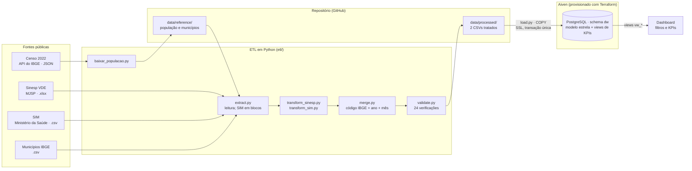
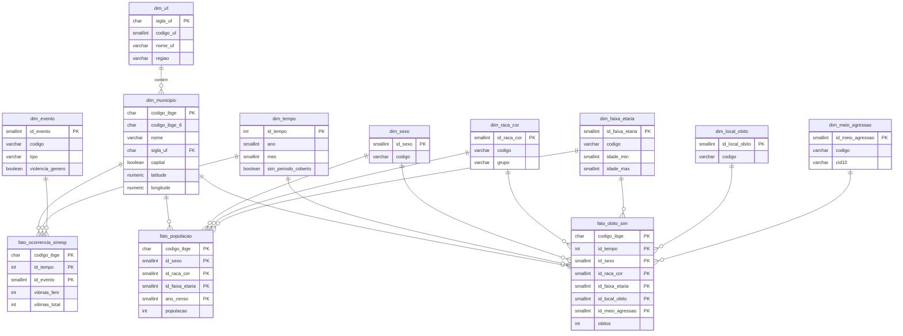

# Monitoramento de Segurança Pública e Feminicídio Interseccional

Projeto prático da disciplina **Big Data & Analytics** (UCSal): pipeline de dados públicos de segurança e saúde (ETL em Python), modelagem em estrela e carga em PostgreSQL provisionado no Aiven via Terraform, como base de um dashboard de análise interseccional de **gênero × raça/cor**.

**Grupo:** João Bruno Reis Carvalho dos Santos · Lucas Danilo Santos Araújo · Maria Fernanda Pereira Barcante Costa · Rafael Farias Castro

## Objetivo

Medir **quem morre por violência no Brasil e onde**, cruzando gênero e raça/cor. O projeto junta, por **município e mês**, os registros policiais de violência letal e de feminicídio (Sinesp/MJSP) com os óbitos por agressão do sistema de saúde (SIM/Ministério da Saúde) e com a população do Censo 2022, em 2024 e 2025. Isso permite responder, com taxas por 100 mil habitantes e não só contagens:

- se mulheres negras e indígenas morrem mais por agressão do que mulheres brancas, e quanto mais;
- se essa desigualdade racial entre mulheres é maior ou menor do que entre homens (**gap interseccional**);
- como as mortes de mulheres diferem das de homens no **local** (domicílio × via pública) e no **meio** (arma de fogo × objeto cortante, força corporal);
- quanto das mortes violentas de mulheres a polícia qualifica como feminicídio, por UF.

**Alinhamento com os ODS:**

| ODS | Meta | Como o projeto contribui |
|---|---|---|
| **ODS 5 — Igualdade de Gênero** | 5.2: eliminar todas as formas de violência contra mulheres e meninas | taxa de feminicídio e de óbitos femininos por agressão por UF e município; % de mortes no domicílio; letalidade do feminicídio; comparação entre o registro policial e o de saúde |
| **ODS 18 — Igualdade Étnico-Racial** (ODS nacional) | eliminar o racismo e as desigualdades étnico-raciais | taxas por raça/cor com o denominador correto (população do mesmo grupo); razão de risco de pessoas negras e indígenas em relação às brancas, separada por sexo e faixa etária |

## Visão geral

O ETL lê as bases públicas sem modificá-las e gera dois CSVs tratados, carregados no PostgreSQL (Aiven). Do **Sinesp VDE 2024 e 2025** (Ministério da Justiça), que traz ocorrências policiais mensais por município, ficam seis eventos: feminicídio, tentativa de feminicídio, homicídio doloso, tentativa de homicídio, lesão corporal seguida de morte e latrocínio. Do **SIM 2024 e 2025** (Ministério da Saúde), em que cada linha é uma declaração de óbito, ficam os óbitos cuja causa básica foi agressão (CID-10 X85 a Y09), de mulheres e de homens. As bases não têm uma chave comum pronta: o Sinesp identifica o município só por UF e nome, enquanto o SIM usa o código IBGE de 6 dígitos do município de residência. O script padroniza o nome do município, obtém o código IBGE por meio de uma tabela de referência e relaciona as bases por **código IBGE + ano + mês**. Como o SIM não registra "feminicídio", o cruzamento é feito por município, e não vítima a vítima: o óbito feminino por agressão serve como aproximação comparada ao que a polícia registrou. **Cada linha do CSV principal representa um município em um mês (2024 ou 2025)**, com a região, as vítimas (mulheres e total) de cada evento do Sinesp, os óbitos femininos por agressão do SIM (no total, por raça/cor e por faixa etária) e a população feminina do município. O **segundo CSV** detalha os óbitos do SIM por sexo × raça/cor × faixa etária × local do óbito × meio da agressão, e a população do Censo 2022 vem com as mesmas dimensões, servindo de denominador para as taxas.
A infraestrutura do banco (serviço PostgreSQL e banco do projeto no Aiven) é declarada como código em [`terraform/`](terraform/), e as credenciais nunca são versionadas (ver [Segurança](#segurança-e-gerenciamento-de-credenciais)).

## Arquitetura



| Camada | Tecnologia | Papel |
|---|---|---|
| Ingestão | Python (pandas, python-calamine, urllib) | Lê as bases brutas sem alterá-las; o SIM é lido em blocos de 200 mil linhas com filtro na leitura, e a população vem da API do IBGE |
| Processamento | Python (pandas) | Limpeza, padronização de chaves, classificação, agregação e validação; gera CSVs versionados e reprodutíveis |
| Armazenamento | PostgreSQL no Aiven (plano gratuito) | Modelo estrela com integridade por chaves e `CHECK`s; views prontas para o dashboard |
| Infraestrutura como código | Terraform (provider `aiven/aiven`) | Cria o serviço PostgreSQL e o banco do projeto de forma reprodutível |
| Segurança | `.env`, `terraform.tfvars`, SSL | Credenciais fora do Git e conexão criptografada |
| Visualização | Dashboard (a desenvolver) | Consome as views `vw_*`; filtros e KPIs definidos em [Regras de negócio](#regras-de-negócio) |

## Bases de dados

| Base | Origem | Formato | Período | Granularidade | Registros |
|---|---|---|---|---|---|
| **Sinesp VDE 2024** | Ministério da Justiça e Segurança Pública ([DNSP – Base de Dados](https://www.gov.br/mj/pt-br/assuntos/sua-seguranca/seguranca-publica/estatistica/download/dnsp-base-de-dados)) | `.xlsx` (~24 MB), aba `2024` | jan–dez/2024, mensal | UF × município × mês × evento | 764.820 |
| **Sinesp VDE 2025** | Ministério da Justiça e Segurança Pública ([DNSP – Base de Dados](https://www.gov.br/mj/pt-br/assuntos/sua-seguranca/seguranca-publica/estatistica/download/dnsp-base-de-dados)) | `.xlsx` (~26 MB), aba `2025` | jan–dez/2025, mensal | UF × município × mês × evento | 832.293 |
| **SIM 2024** | Ministério da Saúde ([OpenDataSUS – SIM](https://dadosabertos.saude.gov.br/dataset/sim)), base consolidada, baixada em 03/11/2026 | `.csv` (no `.zip` `Mortalidade_Geral_2024_csv.zip`), separador `;`, latin-1 (~500 MB) | 01/01 a 31/12/2024 | uma linha por declaração de óbito | 1.527.369 |
| **SIM 2025 – preliminar** | Ministério da Saúde ([OpenDataSUS – SIM](https://dadosabertos.saude.gov.br/dataset/sim)), atualizado em 31/08/2026 | `.csv`, separador `;`, latin-1 (~300 MB) | 01/01 a 02/09/2025 | uma linha por declaração de óbito | 937.033 |
| **Censo Demográfico 2022** (referência) | IBGE, tabela 9606 | API de agregados do IBGE (JSON) → `.csv` UTF-8 | 2022 | município × sexo × faixa etária (população por cor/raça em colunas) | 66.840 |
| **Municípios IBGE** (referência) | [kelvins/municipios-brasileiros](https://github.com/kelvins/municipios-brasileiros) (`csv/municipios.csv`) | `.csv` UTF-8 | — | um município por linha | 5.571 |

**Principais campos utilizados**

- **Sinesp:** `uf`, `municipio`, `evento`, `data_referencia`, `feminino`, `masculino`, `nao_informado`, `total_vitima`, `abrangencia`.
- **SIM:** `DTOBITO`, `SEXO`, `CAUSABAS` (também usado para o meio da agressão), `CODMUNRES`, `RACACOR`, `IDADE` e `LOCOCOR` (usados no resultado), além dos demais campos mapeados na AI02 (`CODMUNOCOR`, `ESTCIV`, `ESC2010`, `CODESTAB`, `NATURAL`, `CODMUNNATU`, `TIPOBITO`), mantidos durante o tratamento.
- **SIM, idade:** `IDADE` é decodificado para anos e agrupado em faixas etárias.
- **Municípios:** `codigo_ibge`, `nome`, `codigo_uf` — necessária porque o Sinesp não tem código IBGE.
- **Censo 2022:** população residente por município, sexo e faixa etária, total e por cor/raça (branca, preta, amarela, parda, indígena). As faixas são as mesmas usadas no SIM (0–17, 18–29, 30–39, 40–49, 50–59, 60+). É o dado oficial mais recente com esse detalhamento por município; as estimativas anuais do IBGE trazem só o total.

O perfil completo das bases brutas (nulos, duplicidades, períodos, inconsistências) está em [`docs/analise_exploratoria.md`](docs/analise_exploratoria.md).

## Conceitos de Big Data

### Os 5 V's no projeto

| V | Como aparece no projeto | Como foi tratado |
|---|---|---|
| **Volume** | ~890 MB de dados brutos: 2,46 milhões de declarações de óbito (SIM 2024 e 2025) e 1,6 milhão de linhas do Sinesp. O CSV do SIM 2024 sozinho tem ~530 MB, acima do que convém abrir de uma vez em memória e do limite de 100 MB do GitHub. | Leitura do SIM em blocos (*chunking*) com filtro durante a leitura: só ~60 mil óbitos por agressão ficam em memória. As bases brutas ficam fora do Git, e o resultado são dois CSVs (~9 MB) e um banco de ~66 MB. |
| **Velocidade** | O Sinesp é atualizado mensalmente; o SIM tem uma base consolidada por ano e versões preliminares atualizadas ao longo do ano seguinte (a de 2025 foi atualizada em 31/08/2026). | Processamento em lote (*batch*), adequado à frequência das fontes. O pipeline é reexecutável de ponta a ponta, e um novo ano ou uma nova versão preliminar entra editando `SINESP_ARQUIVOS`, `SIM_ARQUIVOS` e `SIM_MESES_COBERTOS` em `etl/config.py`. A carga recria o schema numa transação, então pode ser repetida a cada atualização. |
| **Variedade** | Quatro fontes, três formatos e três codificações: Excel (Sinesp), CSV latin-1 com `;` (SIM), JSON aninhado de API (IBGE) e CSV UTF-8 (municípios). As chaves de município também diferem: UF + nome por extenso (Sinesp), código IBGE de 6 dígitos (SIM) e de 7 dígitos (IBGE). | Um módulo de extração por fonte e padronização das chaves: normalização de nomes (acentos, apóstrofos, hífens), tabela de equivalências para 10 municípios com nome divergente e conversão entre códigos de 6 e 7 dígitos. Tudo converge para um único modelo relacional. |
| **Veracidade** | Município "NÃO INFORMADO" no Sinesp, municípios de residência ignorados no SIM, raça/cor e idade ignoradas, SIM 2025 preliminar (agosto incompleto), feminicídio registrado separadamente do homicídio doloso, divergência entre município de residência e de ocorrência. | Cada descarte é contado e documentado ([Resultado](#resultado)); categorias "ignoradas" são mantidas como categoria própria, sem imputação; o período coberto do SIM é marcado em `sim_periodo_coberto`; 24 validações no ETL, conferências na carga e `CHECK`s no banco; limitações explícitas em [Limitações](#limitações). |
| **Valor** | Taxas interseccionais que as fontes, isoladas, não mostram. Em 2024: mulheres negras morreram por agressão a 4,20 por 100 mil, 1,9× a taxa das brancas (2,20), e indígenas a 10,54 (4,8×); 33,7% das mulheres morreram em casa, contra 13,4% dos homens; 27,6% das mulheres foram mortas com objeto cortante, contra 14,8% dos homens; só 37,6% das mortes violentas de mulheres registradas pela polícia foram qualificadas como feminicídio. | Os indicadores estão prontos no banco (`vw_kpi_interseccional`, `vw_kpi_uf`, `vw_taxa_sim_uf`) para orientar políticas de prevenção por território e por grupo (ODS 5 e 18). |

### Tipos de dados

| Tipo | Onde aparece | Tratamento |
|---|---|---|
| **Estruturado** | Sinesp (`.xlsx`), SIM (`.csv`), tabela de municípios (`.csv`) e o próprio banco PostgreSQL | Esquema tabular fixo; lido com pandas e convertido para o modelo estrela |
| **Semiestruturado** | Resposta da API de agregados do IBGE (Censo 2022): JSON aninhado em `resultados → classificacoes → series`, com categorias identificadas por códigos | `etl/baixar_populacao.py` percorre a hierarquia, traduz os códigos de sexo, cor/raça e idade e achata o resultado em um CSV tabular |
| **Não estruturado** | Não é usado. O dicionário do SIM (PDF) serviu só como documentação para mapear os códigos | Textos livres (boletins de ocorrência, notícias) ficaram fora do escopo: não são públicos de forma padronizada e poderiam conter dados pessoais |

## Estrutura do repositório

```text
.
├── data/
│   ├── raw/                      # bases brutas (fora do Git)
│   ├── reference/
│   │   ├── municipios_ibge.csv                # tabela de municípios (versionada)
│   │   └── populacao_censo2022.csv            # população por sexo, faixa etária e cor/raça (versionada)
│   └── processed/
│       ├── violencia_feminicidio_municipio_mes.csv   # painel município × mês (versionado)
│       └── sim_obitos_agressao.csv                   # SIM detalhado por sexo, raça/cor, idade, local e meio (versionado)
├── docs/
│   └── analise_exploratoria.md   # gerado por etl/exploratory_analysis.py
├── etl/
│   ├── config.py                 # caminhos e parâmetros centralizados
│   ├── extract.py                # EXTRAÇÃO: leitura das bases (SIM em blocos)
│   ├── padronizacao.py           # normalização de nomes e códigos IBGE
│   ├── transform_sinesp.py       # TRANSFORMAÇÃO da Base 1
│   ├── transform_sim.py          # TRANSFORMAÇÃO da Base 2
│   ├── merge.py                  # RELACIONAMENTO Sinesp × SIM
│   ├── validate.py               # VALIDAÇÃO do resultado
│   ├── load.py                   # CARGA no PostgreSQL: CSV → modelo estrela (credenciais via .env)
│   ├── main.py                   # pipeline completo (ponto de entrada)
│   ├── baixar_populacao.py       # regenera a tabela de população (API do IBGE)
│   └── exploratory_analysis.py   # análise exploratória das bases brutas
├── sql/
│   └── schema.sql                # modelo estrela do banco: tabelas, dimensões fixas e views
├── terraform/
│   ├── main.tf                   # provider Aiven, serviço PostgreSQL e banco do projeto
│   ├── variables.tf              # variáveis (token da API, projeto, nome do banco)
│   ├── outputs.tf                # host, porta, banco e URIs de conexão (sensíveis)
│   ├── terraform.tfvars.example  # modelo de variáveis (versionado, sem valores reais)
│   └── .terraform.lock.hcl       # versão exata do provider (versionado)
├── .env.example                  # modelo de credenciais do ETL (versionado, campos vazios)
├── requirements.txt
└── README.md
```

## Execução

### 1. Dados brutos

As bases brutas **não são versionadas**: os CSVs do SIM têm de 300 a 500 MB, acima do limite de 100 MB do GitHub. Baixe-as nos portais de origem (links na tabela [Bases de dados](#bases-de-dados); o SIM 2024 vem compactado em `.zip`) e copie para `data/raw/` com estes nomes exatos (configurados em `etl/config.py`):

```text
data/raw/BancoVDE 2024.xlsx
data/raw/BancoVDE 2025 (1).xlsx
data/raw/Mortalidade_Geral_2024.csv
data/raw/Mortalidade_Geral_2025.csv
```

O ETL apenas lê esses arquivos e nunca os modifica.

### 2. Ambiente (Python 3.10+)

```bash
python -m venv .venv

# Windows (PowerShell)
.venv\Scripts\Activate.ps1
# Linux/macOS
source .venv/bin/activate

pip install -r requirements.txt
```

No Windows, se o PowerShell bloquear a ativação, execute uma vez `Set-ExecutionPolicy -Scope CurrentUser RemoteSigned`.

### 3. Rodar o ETL

Na raiz do repositório:

```bash
python -m etl.main
```

Leva cerca de 1 minuto e gera `data/processed/violencia_feminicidio_municipio_mes.csv`. O terminal mostra as contagens de cada etapa e o resultado de cada verificação. Se alguma verificação falhar, o CSV **não** é gravado e o script termina com código 1.

Comandos auxiliares:

| Comando | O que faz |
|---|---|
| `python -m etl.transform_sinesp` | Executa só o tratamento do Sinesp e imprime as contagens |
| `python -m etl.transform_sim` | Executa só o tratamento do SIM e imprime as contagens |
| `python -m etl.exploratory_analysis` | Regenera `docs/analise_exploratoria.md` (~1 min) |
| `python -m etl.baixar_populacao` | Baixa de novo a população do Censo 2022 por sexo, faixa etária e cor/raça (API de agregados do IBGE) e regrava `data/reference/populacao_censo2022.csv`. Só é necessário para atualizar o arquivo, que já está versionado. |

### 4. Provisionar o banco (Terraform)

Requer o [Terraform](https://developer.hashicorp.com/terraform/install) instalado e um token da API do Aiven (console → ícone de usuário → **Tokens** → **Generate token**).

```bash
cd terraform
cp terraform.tfvars.example terraform.tfvars   # preencha o token e o nome do projeto
terraform init
terraform plan                                 # revise o que será criado/alterado
terraform apply
```

O serviço do plano gratuito é desligado automaticamente após um período sem uso. Se o `apply` falhar com `the service is powered off`, ligue o serviço no console do Aiven (menu **⋯** → **Power on service**), aguarde o status **Running** e rode novamente.

### 5. Configurar as credenciais do ETL

Na raiz do repositório:

```bash
cp .env.example .env
```

Preencha o `.env`. Host, porta e nome do banco podem ser obtidos pelo Terraform:

| Variável | Origem |
|---|---|
| `DB_HOST` | `terraform output -raw pg_host` |
| `DB_PORT` | `terraform output -raw pg_port` |
| `DB_NAME` | `terraform output -raw pg_database` |
| `DB_USER` | usuário do serviço no Aiven (`avnadmin`) |
| `DB_PASSWORD` | campo **Password** na página do serviço no console do Aiven |

### 6. Carregar os dados no PostgreSQL

Com o serviço ligado e o `.env` preenchido:

```bash
python -m etl.load
```

O script:

1. lê os CSVs tratados em `data/processed/` (painel e SIM detalhado) e as tabelas de referência (municípios e população);
2. converte os dados para o modelo estrela (ver [Modelagem do banco](#modelagem-do-banco)) e confere que nenhum total se perdeu (vítimas, óbitos e população);
3. recria o schema `dw` a partir de [`sql/schema.sql`](sql/schema.sql) e carrega as tabelas com `COPY`;
4. confere no banco os totais carregados.

Tudo acontece em **uma única transação**: se qualquer passo falhar, nada é gravado. A carga pode ser repetida quantas vezes for preciso, pois o schema é recriado do zero. Se alguma variável do `.env` estiver faltando, o script para antes de conectar, com uma mensagem indicando qual.

Para montar e conferir as tabelas **sem conectar ao banco** (útil para testar o ETL sem o serviço ligado):

```bash
python -m etl.load --dry-run
```

Resultado esperado: `dim_municipio` 5.571 · `dim_tempo` 24 · `fato_ocorrencia_sinesp` 64.428 · `fato_obito_sim` 52.243 · `fato_populacao` 276.501 linhas.

## Fluxo do ETL

```text
EXTRAÇÃO         Sinesp (.xlsx, inteiro)              SIM (.csv, blocos de 200 mil; filtro X85–Y09 na leitura)
                        │                                     │
TRANSFORMAÇÃO    recorte de eventos                    duplicidades
                 município "NÃO INFORMADO"             colunas da AI02 (LGPD)
                 nulos por sexo → 0                    datas → ano/mês
                 soma de linhas repetidas              período coberto
                 tipos, ano/mês                        município de residência ignorado
                 código IBGE (UF + nome)               sexo · raça/cor · faixa etária · local · meio
                 pivot → município × mês               agregação → município × mês (mulheres) e detalhamento
                        │                                     │
RELACIONAMENTO          └──── código IBGE 6 dígitos + ano + mês (FULL OUTER JOIN) ────┘
                                              │
                         cobertura do SIM · remoção de linhas sem ocorrência
                         região (UF) · população feminina (Censo 2022, por código IBGE)
                                              │
VALIDAÇÃO                         24 verificações (chave, nulos, totais...)
                                              │
SAÍDA                  data/processed/violencia_feminicidio_municipio_mes.csv
                       data/processed/sim_obitos_agressao.csv
                                              │
CARGA                   formato largo → modelo estrela (etl/load.py)
                        PostgreSQL no Aiven, schema dw (sql/schema.sql · credenciais do .env · SSL)
```

## Tratamento — Base 1 (Sinesp VDE)

Teste isolado: `python -m etl.transform_sinesp` (imprime as contagens de cada passo).

| # | Passo | Decisão e justificativa |
|---|---|---|
| 1 | Padronização de texto | `uf`, `municipio`, `evento` sem espaços nas pontas; `uf` e `municipio` em maiúsculas. |
| 2 | Recorte temático | Mantém 6 eventos de violência letal e contra a mulher, registrados por município: Feminicídio, Tentativa de feminicídio, Homicídio doloso, Tentativa de homicídio, Lesão corporal seguida de morte, Latrocínio. Estupro e Estupro de vulnerável ficam de fora porque só existem agregados por UF. |
| 3 | Município "NÃO INFORMADO" | Tratado como nulo (AI02). Como não pode ser relacionado a um município do SIM, a linha sai; as vítimas descartadas são contadas (15 no recorte: 8 em 2024 e 7 em 2025). |
| 4 | Nulos por sexo | `feminino`/`masculino`/`nao_informado` nulos viram 0: em todas as linhas `total_vitima` está preenchido e é igual à soma por sexo, então o nulo significa "nenhuma vítima nessa categoria". O script interrompe se essa regra for violada. |
| 5 | Colunas sem uso | `agente`, `arma`, `faixa_etaria`, `total`, `total_peso` (100% nulas no recorte) e `abrangencia` (constante) saem. |
| 6 | Duplicidades | O DF tem 33 linhas por mês/evento, todas como "BRASÍLIA" (provavelmente uma por região administrativa). São **somadas**, não descartadas, para obter o total do município. O script confere que o total de vítimas não muda. |
| 7 | Tipos | Contagens como inteiros; `data_referencia` vira `ano` e `mes`. |
| 8 | Código IBGE | Associado por UF + nome normalizado com `data/reference/municipios_ibge.csv`; 10 grafias divergentes resolvidas por uma lista explícita de equivalências em `etl/config.py`. O nome do município passa a ser o oficial da tabela de referência. |
| 9 | Pivot | Uma linha por **município × mês**; para cada evento, as colunas `sinesp_<evento>_fem` (vítimas femininas) e `sinesp_<evento>_total` (todas as vítimas). |

## Tratamento — Base 2 (SIM)

Teste isolado: `python -m etl.transform_sim` (imprime as contagens de cada passo).

| # | Passo | Decisão e justificativa |
|---|---|---|
| 1 | Recorte na leitura | Cada CSV (937 mil a 1,5 milhão de linhas) é lido em blocos de 200 mil e só ficam em memória os óbitos com causa básica entre X85 e Y09 (agressão), **de ambos os sexos**. Os homens entram para permitir a comparação de gênero (a AI02 previa só mulheres). O `*` do CID é removido antes da comparação, se existir. |
| 2 | Duplicidades | `contador` é só um número sequencial. Linhas idênticas em todas as outras colunas, dentro do mesmo arquivo, são a mesma declaração repetida e são removidas (2 no recorte, ambas de homens). |
| 3 | Colunas | Ficam só as colunas mapeadas na AI02. Data de nascimento, dados da mãe e demais campos saem (minimização de dados, LGPD). |
| 4 | Datas | `DTOBITO` (`ddmmaaaa`) vira data e depois `ano` e `mes`; datas inválidas sairiam (nenhuma). |
| 5 | Período coberto | 2024 é base consolidada (janeiro a dezembro). 2025 é preliminar: óbitos só até 02/09/2025, agosto incompleto; meses considerados cobertos: janeiro a agosto. Configurado por ano em `SIM_MESES_COBERTOS` (`etl/config.py`). |
| 6 | Sexo | `SEXO` vira `feminino` (2) ou `masculino` (1). Sexo ignorado (0) sai, pois não pode entrar nas comparações por gênero (82 óbitos). |
| 7 | Município de residência | `CODMUNRES` é a chave de relacionamento (AI02). Códigos terminados em `0000` indicam município ignorado (só a UF é conhecida) e saem, pois não podem ser ligados a um município (520 óbitos, 28 de mulheres). |
| 8 | Raça/cor | Código convertido em categoria (branca, preta, amarela, parda, indígena); nulo vira `raca_ignorada` (593 óbitos, 44 de mulheres). |
| 9 | Idade | `IDADE` tem 3 dígitos: o 1º é a unidade (0 minutos, 1 horas, 2 dias, 3 meses, 4 anos, 5 = 100 anos ou mais) e os 2 últimos, a quantidade. Menos de 1 ano vira 0; `999` vira `idade_ignorada` (189 óbitos, 6 de mulheres). Faixas: 0–17 (menores de idade), 18–29, 30–39, 40–49, 50–59, 60+ (pessoas idosas), configuráveis em `etl/config.py`. |
| 10 | Local do óbito | `LOCOCOR` vira `estabelecimento_saude` (hospital ou outro serviço de saúde, 1 e 2), `domicilio` (3), `via_publica` (4), `outros` (5) ou `aldeia_indigena` (6); nulo ou 9 vira `local_ignorado` (171 óbitos). O óbito no domicílio é a aproximação de feminicídio usada em estudos como o *Atlas da Violência*. |
| 11 | Meio da agressão | Derivado dos 3 primeiros caracteres do CID (`SIM_MEIO_AGRESSAO` em `etl/config.py`): `arma_fogo` (X93–X95), `objeto_cortante` (X99), `objeto_contundente` (Y00), `forca_corporal` (Y04–Y05), `enforcamento_sufocacao` (X91), `envenenamento` (X85–X90), `maus_tratos` (Y06–Y07), `meio_nao_especificado` (Y09) e `outros` (demais). Não usa nenhuma coluna nova. |
| 12 | Agregação | Duas saídas a partir dos mesmos óbitos: (a) **painel feminino**, uma linha por município × mês com `sim_obitos_fem_agressao` (total), `sim_obitos_fem_<raça>` e `sim_obitos_fem_idade_<faixa>`, que entra no CSV principal; (b) **detalhamento**, uma linha por município × mês × sexo × raça/cor × faixa etária × local × meio, gravado em `sim_obitos_agressao.csv`. O script confere que os totais não mudam e que os óbitos femininos do detalhamento são iguais aos do painel em cada município × mês. |

## Relacionamento (Sinesp × SIM)

```text
Sinesp.uf + Sinesp.municipio ──(tabela IBGE)──► codigo_ibge (7 díg.) ──► 6 primeiros dígitos ┐
Sinesp.data_referencia ──► ano + mes                                                         ├─ chave
SIM.CODMUNRES (6 díg.) + SIM.DTOBITO ──► ano + mes                                           ┘
```

- **Campos:** código IBGE do município (6 dígitos) + ano + mês. O município do SIM é o de **residência** (`CODMUNRES`), como definido na AI02.
- **Padronização:** o Sinesp só tem UF + nome; o nome é normalizado (sem acento, maiúsculas, sem hífen/apóstrofo) e associado ao código IBGE pela tabela de referência. O código de 7 dígitos é reduzido aos 6 usados pelo SIM.
- **Tipo de JOIN:** `FULL OUTER JOIN` sobre a grade município × mês. Assim nenhum óbito do SIM se perde e os municípios sem óbito continuam presentes com os dados do Sinesp.
- **Por quê:** o SIM não registra "feminicídio" e não há identificador comum de vítima entre as bases; o óbito feminino por agressão é usado como aproximação e o cruzamento é feito por município e mês (AI02).
- **Período:** nos meses cobertos pelo SIM (2024 inteiro e jan–ago/2025), município sem óbito recebe 0; nos meses sem cobertura (set–dez/2025), as colunas do SIM ficam vazias (NULL) e `sim_periodo_coberto = False`.
- **Linhas sem ocorrência:** município × mês em que todas as contagens das duas bases são zero é removido (AI02, otimização de volume).
- **Enriquecimento:** a região é derivada da UF; a população feminina do Censo 2022 é associada pelo código IBGE de 7 dígitos (`LEFT JOIN`; todas as linhas encontram população).

## Validação

Antes de gravar os CSVs, `etl/validate.py` executa 24 verificações. Se alguma falhar, nada é gravado. No painel município × mês:

- o resultado não está vazio;
- a chave `codigo_ibge + ano + mes` é única;
- não há nulos nas colunas de identificação;
- `codigo_ibge` tem 7 dígitos, `uf` tem 2 letras maiúsculas e `mes` está entre 1 e 12;
- não há contagens negativas;
- as colunas do SIM não têm nulos nos meses cobertos e são nulas nos meses não cobertos;
- em cada evento do Sinesp, vítimas femininas ≤ total de vítimas;
- a soma por raça/cor e a soma por faixa etária são iguais ao total de óbitos do SIM;
- todas as linhas têm população, e a população total é ≥ a soma por cor/raça (o total inclui cor/raça ignorada);
- o total de vítimas do Sinesp e o total de óbitos do SIM são os mesmos antes e depois do relacionamento.

No detalhamento do SIM (`sim_obitos_agressao.csv`):

- a chave (município × mês × sexo × raça/cor × faixa × local × meio) é única e não há nulos;
- todas as categorias pertencem aos domínios previstos em `etl/config.py` e todas as contagens são positivas;
- só há meses cobertos pelo SIM;
- o total de óbitos é igual ao de óbitos tratados, e os óbitos femininos são iguais aos do painel em **cada** município × mês.

Além disso, cada etapa de transformação confere que as agregações não alteraram os totais, e a carga (`etl/load.py`) refaz as conferências no banco antes de confirmar a transação.

## Resultado

Execução com as bases descritas acima:

| Etapa | Registros |
|---|---|
| **Sinesp** — original (2024 + 2025) | 1.597.113 (764.820 + 832.293) |
| Sinesp — após recorte dos 6 eventos | 810.924 |
| Sinesp — após remover município "NÃO INFORMADO" e somar linhas repetidas | 802.080 |
| Sinesp — tratado (município × mês) | **133.680** (5.570 municípios × 24 meses; 151.806 vítimas) |
| **SIM** — original (2024 + 2025) | 2.464.402 (1.527.369 + 937.033) |
| SIM — após recorte (agressão X85–Y09, ambos os sexos) | 59.794 |
| SIM — após remover duplicidades, sexo ignorado e município de residência ignorado | 59.190 óbitos (53.838 homens · 5.352 mulheres) |
| SIM — painel feminino (município × mês) | **4.162** (1.826 municípios) |
| SIM — detalhamento (`sim_obitos_agressao.csv`) | **52.243** linhas |
| Relacionamento — registros presentes nas duas bases | 4.162 |
| Relacionamento — só no Sinesp (sem óbito no SIM) / só no SIM | 129.518 / 0 |
| Linhas sem nenhuma ocorrência removidas | 89.893 |
| **CSV final** | **43.787 linhas · 39 colunas · 5.065 municípios** (22.430 em 2024 e 21.357 em 2025) |

Totais no CSV final, por ano:

| | 2024 | 2025 |
|---|---|---|
| Vítimas de feminicídio (Sinesp, jan–dez) | 1.494 | 1.566 |
| Óbitos femininos por agressão (SIM) | 3.516 (jan–dez) | 1.836 (jan–ago) |
| — parda / branca / preta / indígena / amarela / ignorada | 2.142 / 1.023 / 250 / 65 / 5 / 31 | 1.087 / 556 / 145 / 34 / 1 / 13 |
| — 0–17 / 18–29 / 30–39 / 40–49 / 50–59 / 60+ / ignorada | 314 / 1.077 / 895 / 643 / 307 / 278 / 2 | 160 / 591 / 486 / 319 / 152 / 124 / 4 |

## Dicionário de dados — CSV final

Arquivo: `data/processed/violencia_feminicidio_municipio_mes.csv` · UTF-8 · separador `,` · cabeçalho na primeira linha · valor vazio = nulo.

**Granularidade:** uma linha por município × mês. **Chave:** `codigo_ibge + ano + mes`.

| Coluna | Tipo | Origem | Descrição |
|---|---|---|---|
| `codigo_ibge` | texto (7 dígitos) | Referência IBGE | Código IBGE do município |
| `uf` | texto (2) | Sinesp | Sigla da UF |
| `regiao` | texto | ETL (a partir da UF) | Região geográfica: Norte, Nordeste, Sudeste, Sul, Centro-Oeste |
| `municipio` | texto | Referência IBGE | Nome oficial do município |
| `ano` | inteiro | Sinesp / SIM | Ano de referência (2024 ou 2025) |
| `mes` | inteiro (1–12) | Sinesp / SIM | Mês de referência |
| `sinesp_feminicidio_fem` | inteiro | Sinesp | Vítimas do sexo feminino de feminicídio |
| `sinesp_feminicidio_total` | inteiro | Sinesp | Total de vítimas de feminicídio |
| `sinesp_tentativa_feminicidio_fem` | inteiro | Sinesp | Vítimas femininas de tentativa de feminicídio |
| `sinesp_tentativa_feminicidio_total` | inteiro | Sinesp | Total de vítimas de tentativa de feminicídio |
| `sinesp_homicidio_doloso_fem` | inteiro | Sinesp | Vítimas femininas de homicídio doloso |
| `sinesp_homicidio_doloso_total` | inteiro | Sinesp | Total de vítimas de homicídio doloso |
| `sinesp_tentativa_homicidio_fem` | inteiro | Sinesp | Vítimas femininas de tentativa de homicídio |
| `sinesp_tentativa_homicidio_total` | inteiro | Sinesp | Total de vítimas de tentativa de homicídio |
| `sinesp_lesao_corporal_morte_fem` | inteiro | Sinesp | Vítimas femininas de lesão corporal seguida de morte |
| `sinesp_lesao_corporal_morte_total` | inteiro | Sinesp | Total de vítimas de lesão corporal seguida de morte |
| `sinesp_latrocinio_fem` | inteiro | Sinesp | Vítimas femininas de latrocínio |
| `sinesp_latrocinio_total` | inteiro | Sinesp | Total de vítimas de latrocínio |
| `sim_periodo_coberto` | booleano | ETL | `True` se o SIM tem dados para o mês (2024 inteiro; jan–ago/2025) |
| `sim_obitos_fem_agressao` | inteiro (nulo fora do período) | SIM | Óbitos de mulheres com causa básica X85–Y09, por município de residência |
| `sim_obitos_fem_branca` | inteiro (nulo fora do período) | SIM | Idem, raça/cor branca |
| `sim_obitos_fem_preta` | inteiro (nulo fora do período) | SIM | Idem, raça/cor preta |
| `sim_obitos_fem_amarela` | inteiro (nulo fora do período) | SIM | Idem, raça/cor amarela |
| `sim_obitos_fem_parda` | inteiro (nulo fora do período) | SIM | Idem, raça/cor parda |
| `sim_obitos_fem_indigena` | inteiro (nulo fora do período) | SIM | Idem, raça/cor indígena |
| `sim_obitos_fem_raca_ignorada` | inteiro (nulo fora do período) | SIM | Idem, raça/cor não informada |
| `sim_obitos_fem_idade_0_17` | inteiro (nulo fora do período) | SIM | Idem, 0 a 17 anos |
| `sim_obitos_fem_idade_18_29` | inteiro (nulo fora do período) | SIM | Idem, 18 a 29 anos |
| `sim_obitos_fem_idade_30_39` | inteiro (nulo fora do período) | SIM | Idem, 30 a 39 anos |
| `sim_obitos_fem_idade_40_49` | inteiro (nulo fora do período) | SIM | Idem, 40 a 49 anos |
| `sim_obitos_fem_idade_50_59` | inteiro (nulo fora do período) | SIM | Idem, 50 a 59 anos |
| `sim_obitos_fem_idade_60_mais` | inteiro (nulo fora do período) | SIM | Idem, 60 anos ou mais |
| `sim_obitos_fem_idade_ignorada` | inteiro (nulo fora do período) | SIM | Idem, idade não informada |
| `pop_fem_total` | inteiro | Censo 2022 | População feminina residente no município (inclui cor/raça ignorada) |
| `pop_fem_branca` | inteiro | Censo 2022 | População feminina branca |
| `pop_fem_preta` | inteiro | Censo 2022 | População feminina preta |
| `pop_fem_amarela` | inteiro | Censo 2022 | População feminina amarela |
| `pop_fem_parda` | inteiro | Censo 2022 | População feminina parda |
| `pop_fem_indigena` | inteiro | Censo 2022 | População feminina indígena |

Regras de leitura: valor `0` significa "nenhum caso registrado"; valor vazio significa "sem dado" (meses não cobertos pelo SIM). Municípios × meses sem nenhuma ocorrência em nenhuma das bases não aparecem no arquivo e devem ser lidos como zero.

## Dicionário de dados — SIM detalhado

Arquivo: `data/processed/sim_obitos_agressao.csv` · UTF-8 · separador `,` · cabeçalho na primeira linha.

**Granularidade:** uma linha por município de residência × mês × sexo × raça/cor × faixa etária × local do óbito × meio da agressão, só com combinações que tiveram pelo menos um óbito e só nos meses cobertos pelo SIM. **Chave:** todas as colunas, exceto `obitos`.

| Coluna | Tipo | Origem | Descrição |
|---|---|---|---|
| `codigo_ibge` | texto (7 dígitos) | Referência IBGE (a partir de `CODMUNRES`) | Município de residência |
| `uf` | texto (2) | Referência IBGE | Sigla da UF |
| `ano` | inteiro | SIM (`DTOBITO`) | Ano do óbito |
| `mes` | inteiro (1–12) | SIM (`DTOBITO`) | Mês do óbito |
| `sexo` | texto | SIM (`SEXO`) | `feminino` ou `masculino` |
| `raca_cor` | texto | SIM (`RACACOR`) | `branca`, `preta`, `amarela`, `parda`, `indigena` ou `raca_ignorada` |
| `faixa_etaria` | texto | SIM (`IDADE`) | `idade_0_17`, `idade_18_29`, `idade_30_39`, `idade_40_49`, `idade_50_59`, `idade_60_mais` ou `idade_ignorada` |
| `local_obito` | texto | SIM (`LOCOCOR`) | `domicilio`, `via_publica`, `estabelecimento_saude`, `aldeia_indigena`, `outros` ou `local_ignorado` |
| `meio_agressao` | texto | SIM (`CAUSABAS`) | `arma_fogo`, `objeto_cortante`, `objeto_contundente`, `forca_corporal`, `enforcamento_sufocacao`, `envenenamento`, `maus_tratos`, `meio_nao_especificado` ou `outros` |
| `obitos` | inteiro (> 0) | ETL | Número de óbitos por agressão na combinação |

Ausência de linha = 0 óbitos. As faixas etárias são as mesmas de `data/reference/populacao_censo2022.csv`, então os dois arquivos se relacionam por `codigo_ibge + sexo + faixa_etaria` (e raça/cor, em colunas na população) para o cálculo de taxas.

## Modelagem do banco

Banco relacional **PostgreSQL** (Aiven), schema `dw`, em **modelo estrela** com a hierarquia geográfica normalizada (município → UF). Definição completa, com tipos, chaves e restrições, em [`sql/schema.sql`](sql/schema.sql).

### Diagrama



### Estrutura

| Tabela | Tipo | Granularidade / conteúdo | Origem | Linhas |
|---|---|---|---|---|
| `fato_ocorrencia_sinesp` | fato | município × mês × evento: vítimas femininas e total | colunas `sinesp_<evento>_fem/_total` do CSV principal | 64.428 |
| `fato_obito_sim` | fato | município × mês × sexo × raça/cor × faixa etária × local × meio: óbitos por agressão | `sim_obitos_agressao.csv` | 52.243 |
| `fato_populacao` | fato | município × sexo × raça/cor × faixa etária: população (Censo 2022) | `populacao_censo2022.csv` | 276.501 |
| `dim_municipio` | dimensão | município, com código IBGE de 7 e 6 dígitos, capital e coordenadas | `municipios_ibge.csv` | 5.571 |
| `dim_uf` | dimensão | UF e região | fixa no `schema.sql` | 27 |
| `dim_tempo` | dimensão | mês, trimestre, semestre e cobertura do SIM | `etl/load.py` | 24 |
| `dim_evento` | dimensão | evento do Sinesp, tipo (consumado/tentativa) e se é violência de gênero | fixa no `schema.sql` | 6 |
| `dim_sexo` | dimensão | feminino, masculino | fixa no `schema.sql` | 2 |
| `dim_raca_cor` | dimensão | raça/cor (códigos do IBGE) e grupo (Negra = preta + parda) | fixa no `schema.sql` | 6 |
| `dim_faixa_etaria` | dimensão | faixa etária, com idade mínima e máxima | fixa no `schema.sql` | 7 |
| `dim_local_obito` | dimensão | local do óbito (domicílio, via pública, estabelecimento de saúde...) | fixa no `schema.sql` | 6 |
| `dim_meio_agressao` | dimensão | meio da agressão e faixa de CID-10 correspondente | fixa no `schema.sql` | 9 |

O schema carregado ocupa cerca de **66 MB**, bem abaixo do limite de 1 GB do plano gratuito do Aiven.

### Estratégia de organização dos dados

- **Do CSV largo para o formato longo.** O CSV principal tem uma coluna por evento (39 colunas). No banco, essas colunas viram linhas na tabela fato, ligadas às dimensões. Assim cada filtro do dashboard (região/UF/município, ano/mês, evento, sexo, raça/cor, faixa etária, local, meio) vira um `WHERE` ou `GROUP BY`, sem escolher colunas, e uma nova categoria entra como linha nova, sem alterar a estrutura.
- **Um único fato do SIM com todas as dimensões do perfil.** `fato_obito_sim` cruza sexo, raça/cor, faixa etária, local do óbito e meio da agressão. Qualquer combinação de filtros é possível (por exemplo, mulheres negras de 18 a 29 anos mortas no domicílio) e a soma de qualquer recorte dá o total correto.
- **População com as mesmas dimensões dos óbitos.** `fato_populacao` usa as mesmas chaves de sexo, raça/cor e faixa etária, então numerador e denominador de uma taxa podem ser filtrados pelo mesmo recorte. A população não se repete por mês (não há risco de somá-la 12 vezes) e inclui todos os 5.570 municípios, também os que não tiveram ocorrência. Raça "ignorada" = total − soma das cinco categorias.
- **Fatos esparsos.** Só são gravadas combinações com pelo menos um caso (ou uma pessoa, na população); ausência de linha = 0. Exceção: nos meses fora da cobertura do SIM (`dim_tempo.sim_periodo_coberto = false`), ausência de linha em `fato_obito_sim` significa "sem dado", e não zero.
- **Integridade no banco.** Chaves primárias compostas nos fatos, chaves estrangeiras para todas as dimensões e `CHECK`s (contagens positivas, vítimas femininas ≤ total, código IBGE com 7 dígitos, mês entre 1 e 12) garantem a veracidade dos dados mesmo fora do ETL. A carga também confere que os ids das dimensões fixas no `schema.sql` são os mesmos usados pelo `etl/load.py`.
- **Nenhum dado pessoal.** O menor nível de detalhe é uma contagem por município × mês × perfil (LGPD).

### Views para o dashboard

| View | Conteúdo |
|---|---|
| `vw_sinesp` | vítimas do Sinesp com região, UF, município, ano, mês e evento já resolvidos |
| `vw_sim` | óbitos do SIM com todos os atributos de filtro (região, UF, município, ano, mês, sexo, raça/cor, grupo racial, faixa etária, local, meio) |
| `vw_populacao` | população do Censo 2022 com região, UF, município, sexo, raça/cor e faixa etária |
| `vw_taxa_sim_uf` | **base das taxas do SIM:** ano × UF × sexo × raça/cor × faixa etária, com óbitos (total, no domicílio e por arma de fogo), população e meses cobertos. Inclui as combinações sem óbito, então serve de denominador completo para qualquer recorte |
| `vw_kpi_interseccional` | Brasil, por ano × sexo × grupo racial: taxa por 100 mil (simples e anualizada), **razão em relação ao grupo branco do mesmo sexo** e % de óbitos no domicílio |
| `vw_kpi_uf` | por ano × UF: feminicídios, taxa de feminicídio por 100 mil mulheres, % de feminicídios entre as mortes violentas de mulheres, letalidade do feminicídio, óbitos femininos no SIM e % no domicílio |
| `vw_comparativo_sinesp_sim` | por ano × município: feminicídios registrados pela polícia × óbitos femininos por agressão, nos meses cobertos pelo SIM |

Para qualquer taxa, some numerador e denominador no recorte desejado e só então divida: `SUM(obitos) * 100000 / SUM(populacao)`. Para comparar 2025 (8 meses) com 2024, multiplique por `12 / meses_cobertos` (taxa anualizada). Exemplos:

```sql
-- Taxa de homicídio por sexo × grupo racial e razão em relação ao grupo branco (Brasil)
SELECT ano, sexo, grupo_racial, taxa_100mil_anualizada, razao_vs_branca, pct_domicilio
FROM dw.vw_kpi_interseccional
WHERE grupo_racial IN ('Branca', 'Negra', 'Indígena')
ORDER BY ano, sexo, grupo_racial;
-- 2024 · feminino:  Branca 2,20 · Negra 4,20 (1,91×) · Indígena 10,54 (4,79×)
-- 2024 · masculino: Branca 17,09 · Negra 50,13 (2,93×) · Indígena 28,47 (1,67×)

-- Recorte livre: mulheres negras de 18 a 29 anos, por UF, em 2024
SELECT sigla_uf, SUM(obitos) AS obitos,
       ROUND(SUM(obitos) * 100000.0 / SUM(populacao), 2) AS taxa_100mil
FROM dw.vw_taxa_sim_uf
WHERE ano = 2024 AND sexo = 'feminino' AND grupo_racial = 'Negra' AND faixa_etaria = 'idade_18_29'
GROUP BY sigla_uf
ORDER BY taxa_100mil DESC;
```

## Regras de negócio

As regras abaixo definem **o que é contado** e **como cada indicador é calculado**. Elas estão implementadas no ETL (`etl/config.py`, `etl/transform_*.py`) e nas views do banco (`sql/schema.sql`), e devem ser seguidas pelo dashboard.

### Recortes

| Regra | Definição |
|---|---|
| **RN01 · Eventos do Sinesp** | Feminicídio, tentativa de feminicídio, homicídio doloso, tentativa de homicídio, lesão corporal seguida de morte e latrocínio, registrados por município (filtro `abrangencia = Estadual` da planilha, `SINESP_ABRANGENCIA` em `etl/config.py`). |
| **RN02 · Óbito por agressão (SIM)** | Causa básica entre X85 e Y09 da CID-10, de ambos os sexos; óbitos com sexo ignorado são excluídos. |
| **RN03 · Unidade geográfica** | Sinesp: município da ocorrência. SIM: município de **residência** (`CODMUNRES`). Registros sem município identificável são excluídos e contados. |
| **RN04 · Período** | 2024 (Sinesp e SIM completos) e 2025 (Sinesp completo; SIM só de janeiro a agosto, `sim_periodo_coberto = true`). Comparações entre as fontes usam só os meses cobertos pelo SIM. |
| **RN05 · Mortes violentas de mulheres (Sinesp)** | Soma das vítimas femininas dos eventos consumados: feminicídio + homicídio doloso + lesão corporal seguida de morte + latrocínio. O Sinesp registra o feminicídio separadamente do homicídio doloso, por isso os dois são somados. |

### Classificações

| Regra | Definição |
|---|---|
| **RN06 · Grupo racial** | Negra = preta + parda (padrão do IBGE); branca, amarela e indígena como estão; "ignorada" é mantida como categoria própria e excluída do cálculo de razões entre grupos. |
| **RN07 · Faixa etária** | 0–17, 18–29, 30–39, 40–49, 50–59, 60+ e ignorada. As mesmas faixas são usadas no SIM e na população, para que o denominador corresponda ao numerador. |
| **RN08 · Local do óbito** | Domicílio, via pública, estabelecimento de saúde, aldeia indígena, outros e ignorado (`LOCOCOR`). |
| **RN09 · Meio da agressão** | Derivado do CID: arma de fogo (X93–X95), objeto cortante (X99), objeto contundente (Y00), força corporal (Y04–Y05), enforcamento/sufocação (X91), envenenamento (X85–X90), maus-tratos (Y06–Y07), não especificado (Y09) e outros. |

### Indicadores (KPIs)

| Regra | Indicador | Fórmula | Onde está |
|---|---|---|---|
| **RN10** | Taxa por 100 mil habitantes | `SUM(casos) / SUM(população do mesmo recorte) × 100.000`, somando numerador e denominador **antes** de dividir; a população é a do Censo 2022, com os mesmos filtros de sexo, raça/cor e faixa etária | `vw_taxa_sim_uf`, `vw_kpi_uf` |
| **RN11** | Taxa anualizada | `taxa × 12 / meses cobertos`; necessária para comparar 2025 (8 meses no SIM) com 2024 | `vw_kpi_interseccional` |
| **RN12** | Taxa de feminicídio | feminicídios (Sinesp) ÷ população feminina × 100.000 | `vw_kpi_uf` |
| **RN13** | Razão de risco racial | taxa do grupo ÷ taxa do grupo branco **do mesmo sexo e ano** (ex.: 1,91 = 91% mais risco) | `vw_kpi_interseccional` |
| **RN14** | Gap interseccional | comparação da razão de risco racial entre mulheres e entre homens (em 2024: 1,91× entre mulheres e 2,93× entre homens), complementada pela diferença absoluta de taxas | `vw_kpi_interseccional` |
| **RN15** | % de óbitos femininos no domicílio | óbitos de mulheres no domicílio ÷ óbitos de mulheres (SIM); aproximação de feminicídio íntimo | `vw_kpi_uf`, `vw_kpi_interseccional` |
| **RN16** | % de feminicídio entre as mortes violentas de mulheres | feminicídios ÷ mortes violentas de mulheres (RN05) | `vw_kpi_uf` |
| **RN17** | Letalidade do feminicídio | feminicídios ÷ (feminicídios + tentativas); vazia quando a UF não registra tentativas no ano | `vw_kpi_uf` |
| **RN18** | Comparativo polícia × saúde | feminicídios e mortes violentas de mulheres (Sinesp) × óbitos femininos por agressão (SIM), por município, nos meses cobertos | `vw_comparativo_sinesp_sim` |

### Regras para o dashboard

| Regra | Definição |
|---|---|
| **RN19 · Filtros** | Ano; região → UF → município (*drill-down*); sexo; grupo racial ou raça/cor; faixa etária; local do óbito; meio da agressão; evento do Sinesp. Todos correspondem a colunas das views `vw_*`. |
| **RN20 · Seletor de métrica** | Contagem absoluta, taxa por 100 mil, taxa anualizada, razão de risco e % do total. |
| **RN21 · Taxas sempre com a contagem** | Toda taxa é exibida junto com o número absoluto de casos, porque grupos pequenos (ex.: 65 óbitos de mulheres indígenas em 2024) geram taxas instáveis. |
| **RN22 · Células pequenas** | Em recortes por município, contagens de 1 ou 2 casos são exibidas como "≤ 2", e taxas municipais só são exibidas a partir de 10 casos no recorte (ver [LGPD e ética](#lgpd-e-ética)). |

## Decisões técnicas

| Decisão | Alternativas consideradas | Justificativa |
|---|---|---|
| **Banco relacional (PostgreSQL)** | banco não relacional (ex.: OpenSearch, MongoDB) | Os dados são estruturados e tabulares (contagens por município, mês e categoria), com relacionamentos fixos entre fatos e dimensões. O relacional garante integridade com chaves e `CHECK`s e responde bem às agregações do dashboard (`GROUP BY`, `JOIN`). Não há texto livre nem documentos semiestruturados que justifiquem um banco não relacional. |
| **Aiven, plano gratuito** | outros provedores de nuvem | Plataforma indicada pela disciplina; PostgreSQL gerenciado sem custo e com provider oficial para Terraform. O limite de 1 GB é suficiente (o schema ocupa ~66 MB). |
| **Terraform (IaC)** | criar o serviço manualmente no console | A infraestrutura fica versionada e reproduzível; qualquer integrante recria o serviço com `terraform apply`. |
| **Modelo estrela** | uma tabela única igual ao CSV; modelo totalmente normalizado | A tabela única repetiria a população em todos os meses e exigiria escolher colunas para cada filtro. O modelo totalmente normalizado aumentaria os `JOIN`s sem ganho para consultas analíticas. A estrela é o padrão para leitura analítica e encaixa nos filtros do dashboard. |
| **Hierarquia município → UF normalizada** | região e UF repetidas em cada município | Permite o drill-down Região → UF → Município com uma única fonte para nome e região de cada UF. |
| **Um fato do SIM com sexo × raça/cor × faixa etária × local × meio** | um fato por dimensão (raça e faixa separados) | Fatos separados impediriam os filtros cruzados (raça **e** idade **e** sexo), que são o centro da análise interseccional. O volume continua pequeno (~52 mil linhas). |
| **População por sexo × raça/cor × faixa etária** | só a população feminina total por raça | Permite taxas no mesmo recorte do numerador (homens, faixas etárias) e o cálculo da razão de risco entre grupos. |
| **Carga com `COPY` em transação única, recriando o schema** | `INSERT` linha a linha; carga incremental | `COPY` é a forma mais rápida de carga no PostgreSQL; a transação única evita banco carregado pela metade; recriar o schema torna a carga repetível. O volume (~400 mil linhas) não justifica carga incremental. |
| **psycopg 3 + python-dotenv** | SQLAlchemy | Driver oficial e leve, com suporte direto a `COPY`; o `python-dotenv` lê as credenciais do `.env` sem colocá-las no código. |

## Infraestrutura (Terraform + Aiven)

O banco é provisionado como código em `terraform/`, usando o provider oficial `aiven/aiven`, com a versão fixada em `~> 4.62` e travada no `.terraform.lock.hcl`.

| Recurso | Descrição |
|---|---|
| `aiven_pg.postgresql` | Serviço PostgreSQL `db-seguranca-publica` (plano `free-1-1gb`, nuvem `do-nyc`) |
| `aiven_pg_database.projeto` | Banco do projeto, `seguranca_publica` por padrão (variável `pg_database_name`) |

| Output | Sensível | Uso |
|---|---|---|
| `pg_host` | não | host do serviço |
| `pg_port` | não | porta do serviço |
| `pg_database` | não | nome do banco do projeto |
| `pg_uri` | sim | URI de conexão apontando para o `defaultdb` |
| `pg_database_uri` | sim | URI de conexão apontando para o banco do projeto |

Outputs sensíveis não aparecem no terminal; para ler: `terraform output -raw pg_database_uri`.

**State:** o state do Terraform é local (`terraform/terraform.tfstate`) e não é versionado. Somente quem tem esse arquivo consegue gerenciar a infraestrutura existente; sem ele, o Terraform tentaria criar o serviço novamente.

## Segurança e gerenciamento de credenciais

Nenhuma credencial é versionada neste repositório. Cada parte do projeto lê seus segredos de um arquivo local ignorado pelo Git, e o repositório contém apenas modelos com os campos vazios.

### ETL (Python) → `.env`

O `etl/load.py` lê as credenciais do banco (`DB_HOST`, `DB_PORT`, `DB_NAME`, `DB_USER`, `DB_PASSWORD`) de um arquivo `.env` na raiz do repositório, carregado com `python-dotenv`. O modelo é o `.env.example`. Se alguma variável estiver ausente, a carga é interrompida antes de qualquer conexão.

### Terraform → `terraform.tfvars` ou `TF_VAR_*`

O token da API do Aiven e o nome do projeto são variáveis do Terraform, informadas de uma destas formas:

- **Arquivo local:** `terraform/terraform.tfvars`, criado a partir do `terraform.tfvars.example`;
- **Variáveis de ambiente:** `export TF_VAR_aiven_api_token="..."` e `export TF_VAR_aiven_project_name="..."`, útil em CI/CD ou para não manter o token em arquivo.

A variável `aiven_api_token` é marcada como `sensitive`, e as URIs de conexão são outputs sensíveis.

### O que nunca é versionado

| Arquivo | Motivo |
|---|---|
| `.env` | credenciais do banco usadas pelo ETL |
| `terraform/terraform.tfvars` | token da API do Aiven |
| `terraform/*.tfstate` | o state guarda a senha e a URI do banco em texto puro |
| `terraform/.terraform/` | plugins baixados pelo `terraform init` |

São versionados apenas os modelos `.env.example` e `terraform/terraform.tfvars.example`, além do `terraform/.terraform.lock.hcl`, que não contém segredos e garante a mesma versão do provider para todo o grupo.

### Conexão criptografada (SSL)

O PostgreSQL no Aiven só aceita conexões com SSL. O ETL conecta com `sslmode=require`, garantindo que os dados e as credenciais trafeguem criptografados entre a aplicação e o banco.

## LGPD e ética

- **Origem dos dados:** todas as bases são dados abertos publicados por órgãos públicos (MJSP, Ministério da Saúde e IBGE). Os microdados do SIM já são divulgados sem nome, documento ou endereço das pessoas.
- **Dados sensíveis:** raça/cor e causa de morte são dados pessoais sensíveis pela LGPD (art. 5º, II: origem racial e dados referentes à saúde). Por isso o projeto **nunca guarda registros individuais**: o SIM é agregado já no ETL, e a data do óbito é reduzida a ano e mês.
- **Anonimização:** o menor nível de detalhe nas saídas e no banco é uma contagem por município × mês × perfil (sexo, raça/cor, faixa etária, local, meio). Dados anonimizados não são considerados dados pessoais (art. 12), desde que a anonimização não possa ser revertida com esforço razoável.
- **Risco de reidentificação:** em municípios pequenos, uma contagem de 1 óbito num perfil muito específico pode, combinada com notícias locais, apontar para uma pessoa. Por isso o dashboard deve aplicar a regra de células pequenas (RN22) e privilegiar recortes por UF e região.
- **Finalidade:** uso acadêmico e de interesse público (prevenção da violência e redução de desigualdades), sem qualquer tentativa de identificar vítimas.
- **Segurança:** credenciais fora do Git, conexão com o banco só por SSL e acesso ao serviço restrito à conta do grupo no Aiven (ver [Segurança](#segurança-e-gerenciamento-de-credenciais)).
- **Comunicação responsável:** os resultados descrevem desigualdades entre grupos e não devem ser usados para estigmatizar grupos ou territórios. As limitações das fontes (subnotificação, raça/cor ignorada, SIM preliminar) acompanham os números.

## Uso da população (taxas)

As colunas `pop_fem_*` são atributos do **município**: o mesmo valor se repete em todas as linhas (meses) dele. Duas regras para calcular taxas corretamente:

1. **Nunca somar a população linha a linha.** Somar `pop_fem_total` de 12 meses multiplica a população por 12. Agregue primeiro um valor por município (máximo ou valor distinto) e só depois some.
2. **Para Brasil, região ou UF, use o denominador completo.** O CSV não traz os municípios sem nenhuma ocorrência no ano (965 em 2024 e 1.080 em 2025, com 2,3% e 2,7% das mulheres), porque essas linhas foram removidas. Para taxas agregadas, use `data/reference/populacao_censo2022.csv` (linhas com `sexo = feminino`, somadas por município) como tabela de dimensão (relacionada por `codigo_ibge`), que tem todos os 5.570 municípios.

No banco, essas duas regras já estão resolvidas: a população fica em `fato_populacao` (uma linha por município × sexo × raça/cor × faixa etária, sem repetir por mês) e inclui todos os 5.570 municípios; `vw_taxa_sim_uf` já traz numerador e denominador lado a lado. As regras acima valem para quem usar o CSV diretamente.

Fórmula: `taxa por 100 mil = casos / população feminina × 100.000`. Para comparar Sinesp e SIM, restrinja aos meses com `sim_periodo_coberto = True`.

Exemplos com os dados atuais (SIM, denominador completo): em 2024 (ano inteiro), 2,20 óbitos por agressão por 100 mil mulheres brancas, 4,20 por 100 mil mulheres negras (pretas + pardas) e 10,54 por 100 mil mulheres indígenas; em 2025 (jan–ago), 1,20, 2,16 e 5,51. Feminicídios (Sinesp, ano inteiro): 1,43 por 100 mil mulheres em 2024 e 1,50 em 2025. Taxas de 2025 cobrem só 8 meses e não devem ser comparadas diretamente com as de 2024.

## Limitações

- **Feminicídio × óbito por agressão:** o SIM não tem a categoria feminicídio. O óbito feminino por agressão (X85–Y09) inclui feminicídios e outros homicídios de mulheres, então a comparação com o Sinesp é aproximada e só faz sentido no agregado por município, não vítima a vítima.
- **SIM 2025 preliminar:** só há óbitos até 02/09/2025, e agosto está incompleto (cerca de metade do volume dos meses anteriores). Comparações entre as bases devem usar `sim_periodo_coberto = True` e considerar a subnotificação de agosto. Pelo mesmo motivo, a taxa anualizada de 2025 (`× 12 / 8`) tende a subestimar o ano.
- **Residência × ocorrência:** o SIM é relacionado pelo município de **residência** (AI02), enquanto o Sinesp registra o local da ocorrência. Em 21,5% dos óbitos femininos do recorte (2024 e 2025) os dois municípios são diferentes.
- **Registros descartados por falta de município:** 15 vítimas do Sinesp (município "NÃO INFORMADO") e 520 óbitos do SIM (município de residência ignorado; 28 de mulheres).
- **Eventos sem detalhe municipal:** Estupro e Estupro de vulnerável existem no Sinesp só por UF e não entram no cruzamento.
- **Perfil das vítimas:** o detalhamento do SIM preserva sexo, raça/cor, faixa etária, local do óbito e meio da agressão; escolaridade e estado civil não estão nas saídas. O Sinesp não tem raça/cor nem idade, então os cruzamentos interseccionais só são possíveis com o SIM.
- **Células pequenas:** no detalhamento, muitas combinações têm 1 óbito. Os dados vêm de microdados já públicos e não identificam pessoas, mas painéis e relatórios devem preferir recortes agregados (UF, região, ano) para análise.
- **Distrito Federal:** o Sinesp traz várias linhas por mês para "BRASÍLIA" (provavelmente uma por região administrativa); elas foram somadas e não é possível separá-las.
- **População de 2022 para casos de 2024 e 2025:** o Censo 2022 é o dado mais recente com sexo e cor/raça por município; usar 2022 como denominador pode subestimar levemente a população (e superestimar as taxas) em municípios que cresceram. 
- **Municípios pequenos:** com 0, 1 ou 2 casos, taxas e razões oscilam muito; prefira conclusões por UF ou região.
- **Tabela de municípios:** vem de um repositório público mantido pela comunidade, não diretamente do IBGE. Alguns nomes incluem a denominação alternativa entre parênteses (ex.: "Augusto Severo (Campo Grande)").
- **Plano gratuito do Aiven:** o serviço é desligado após um período de inatividade e precisa ser religado no console antes da carga ou de qualquer `terraform apply`.
