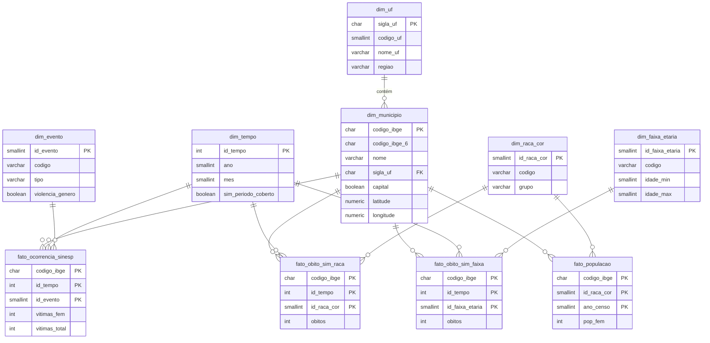

# Monitoramento de Segurança Pública e Feminicídio Interseccional

Projeto prático da disciplina **Big Data & Analytics** (UCSal) — etapa AI04 (continuação da AI03): tratamento dos dados, modelagem e carga no banco PostgreSQL provisionado no Aiven via Terraform.

**Grupo:** João Bruno Reis Carvalho dos Santos · Lucas Danilo Santos Araújo · Maria Fernanda Pereira Barcante Costa · Rafael Farias Castro

## Objetivo

Cruzar, por **município e mês**, os registros policiais de violência letal e de violência contra mulheres (Sinesp/MJSP) com os óbitos de mulheres por agressão registrados no sistema de saúde (SIM/Ministério da Saúde), em 2025, permitindo comparar as duas fontes e analisar o perfil racial das vítimas.

Alinhamento: ODS 5 (Igualdade de Gênero) e ODS 18 (Igualdade Étnico-Racial).

## Visão geral

O ETL lê as duas bases públicas sem modificá-las e gera um único CSV tratado, que é carregado no PostgreSQL (Aiven). Do **Sinesp VDE 2025** (Ministério da Justiça), que traz ocorrências policiais mensais por município, ficam seis eventos: feminicídio, tentativa de feminicídio, homicídio doloso, tentativa de homicídio, lesão corporal seguida de morte e latrocínio. Do **SIM 2025** (Ministério da Saúde), em que cada linha é uma declaração de óbito, ficam apenas os óbitos de mulheres cuja causa básica foi agressão (CID-10 X85 a Y09). As bases não têm uma chave comum pronta: o Sinesp identifica o município só por UF e nome, enquanto o SIM usa o código IBGE de 6 dígitos do município de residência. O script padroniza o nome do município, obtém o código IBGE por meio de uma tabela de referência e relaciona as bases por **código IBGE + ano + mês**. Como o SIM não registra "feminicídio", o cruzamento é feito por município, e não vítima a vítima: o óbito feminino por agressão serve como aproximação comparada ao que a polícia registrou. **Cada linha do CSV final representa um município em um mês de 2025**, com a região, as vítimas (mulheres e total) de cada evento do Sinesp, os óbitos femininos por agressão do SIM (no total, por raça/cor e por faixa etária) e a população feminina do município segundo o Censo 2022 (total e por raça/cor), que serve de denominador para taxas.
A infraestrutura do banco (serviço PostgreSQL e banco do projeto no Aiven) é declarada como código em [`terraform/`](terraform/), e as credenciais nunca são versionadas (ver [Segurança](#segurança-e-gerenciamento-de-credenciais)).

## Bases de dados

| Base | Origem | Formato | Período | Granularidade | Registros |
|---|---|---|---|---|---|
| **Sinesp VDE 2025** | Ministério da Justiça e Segurança Pública (portal de dados abertos) | `.xlsx` (~26 MB), aba `2025` | jan–dez/2025, mensal | UF × município × mês × evento | 832.293 |
| **SIM 2025 – preliminar** | Ministério da Saúde (OpenDataSUS), atualizado em 31/08/2026 | `.csv`, separador `;`, latin-1 (~300 MB) | 01/01 a 02/09/2025 | uma linha por declaração de óbito | 937.033 |
| **Censo Demográfico 2022** (referência) | IBGE, tabela SIDRA 9606 | API SIDRA → `.csv` UTF-8 | 2022 | um município por linha (mulheres, por cor/raça) | 5.570 |
| **Municípios IBGE** (referência) | [kelvins/municipios-brasileiros](https://github.com/kelvins/municipios-brasileiros) (`csv/municipios.csv`) | `.csv` UTF-8 | — | um município por linha | 5.571 |

**Principais campos utilizados**

- **Sinesp:** `uf`, `municipio`, `evento`, `data_referencia`, `feminino`, `masculino`, `nao_informado`, `total_vitima`, `abrangencia`.
- **SIM:** `DTOBITO`, `SEXO`, `CAUSABAS`, `CODMUNRES`, `RACACOR` (usados no resultado), além dos demais campos mapeados na AI02 (`CODMUNOCOR`, `IDADE`, `ESTCIV`, `ESC2010`, `LOCOCOR`, `CODESTAB`, `NATURAL`, `CODMUNNATU`, `TIPOBITO`), mantidos durante o tratamento.
- **SIM, idade:** `IDADE` é decodificado para anos e agrupado em faixas etárias.
- **Municípios:** `codigo_ibge`, `nome`, `codigo_uf` — necessária porque o Sinesp não tem código IBGE.
- **Censo 2022:** população residente feminina por município, total e por cor/raça (branca, preta, amarela, parda, indígena). É o dado oficial mais recente com esse detalhamento por município; as estimativas anuais do IBGE trazem só o total.

O perfil completo das bases brutas (nulos, duplicidades, períodos, inconsistências) está em [`docs/analise_exploratoria.md`](docs/analise_exploratoria.md).

## Estrutura do repositório

```text
.
├── data/
│   ├── raw/                      # bases brutas (fora do Git)
│   ├── reference/
│   │   ├── municipios_ibge.csv                # tabela de municípios (versionada)
│   │   └── populacao_feminina_censo2022.csv   # população feminina (versionada)
│   └── processed/
│       └── violencia_feminicidio_municipio_mes_2025.csv   # saída do ETL (versionada)
├── docs/
│   └── analise_exploratoria.md   # gerado por etl/exploratory_analysis.py
├── etl/
│   ├── config.py                 # caminhos e parâmetros centralizados
│   ├── extract.py                # EXTRAÇÃO: leitura das bases (SIM em blocos)
│   ├── padronizacao.py           # normalização de nomes e códigos IBGE
│   ├── transform_sinesp.py       # TRANSFORMAÇÃO da Base 1
│   ├── transform_sim.py          # TRANSFORMAÇÃO da Base 2
│   ├── merge.py                  # RELACIONAMENTO Sinesp × SIM
│   ├── validate.py               # VALIDAÇÃO do resultado
│   ├── load.py                   # CARGA no PostgreSQL: CSV → modelo estrela (credenciais via .env)
│   ├── main.py                   # pipeline completo (ponto de entrada)
│   ├── baixar_populacao.py       # regenera a tabela de população (API SIDRA/IBGE)
│   └── exploratory_analysis.py   # análise exploratória das bases brutas
├── sql/
│   └── schema.sql                # modelo estrela do banco: tabelas, dimensões fixas e views
├── terraform/
│   ├── main.tf                   # provider Aiven, serviço PostgreSQL e banco do projeto
│   ├── variables.tf              # variáveis (token da API, projeto, nome do banco)
│   ├── outputs.tf                # host, porta, banco e URIs de conexão (sensíveis)
│   ├── terraform.tfvars.example  # modelo de variáveis (versionado, sem valores reais)
│   └── .terraform.lock.hcl       # versão exata do provider (versionado)
├── .env.example                  # modelo de credenciais do ETL (versionado, campos vazios)
├── requirements.txt
└── README.md
```

## Execução

### 1. Dados brutos

As bases brutas **não são versionadas**: o CSV do SIM tem ~300 MB, acima do limite de 100 MB do GitHub. Baixe-as nos portais de origem e copie para `data/raw/` com estes nomes exatos (configurados em `etl/config.py`):

```text
data/raw/BancoVDE 2025 (1).xlsx
data/raw/Mortalidade_Geral_2025.csv
```

O ETL apenas lê esses arquivos e nunca os modifica.

### 2. Ambiente (Python 3.10+)

```bash
python -m venv .venv

# Windows (PowerShell)
.venv\Scripts\Activate.ps1
# Linux/macOS
source .venv/bin/activate

pip install -r requirements.txt
```

No Windows, se o PowerShell bloquear a ativação, execute uma vez `Set-ExecutionPolicy -Scope CurrentUser RemoteSigned`.

### 3. Rodar o ETL

Na raiz do repositório:

```bash
python -m etl.main
```

Leva cerca de 30 segundos e gera `data/processed/violencia_feminicidio_municipio_mes_2025.csv`. O terminal mostra as contagens de cada etapa e o resultado de cada verificação. Se alguma verificação falhar, o CSV **não** é gravado e o script termina com código 1.

Comandos auxiliares:

| Comando | O que faz |
|---|---|
| `python -m etl.transform_sinesp` | Executa só o tratamento do Sinesp e imprime as contagens |
| `python -m etl.transform_sim` | Executa só o tratamento do SIM e imprime as contagens |
| `python -m etl.exploratory_analysis` | Regenera `docs/analise_exploratoria.md` (~1 min) |
| `python -m etl.baixar_populacao` | Baixa de novo a população feminina do Censo 2022 (API SIDRA/IBGE) e regrava `data/reference/populacao_feminina_censo2022.csv`. Só é necessário para atualizar o arquivo, que já está versionado. |

### 4. Provisionar o banco (Terraform)

Requer o [Terraform](https://developer.hashicorp.com/terraform/install) instalado e um token da API do Aiven (console → ícone de usuário → **Tokens** → **Generate token**).

```bash
cd terraform
cp terraform.tfvars.example terraform.tfvars   # preencha o token e o nome do projeto
terraform init
terraform plan                                 # revise o que será criado/alterado
terraform apply
```

O serviço do plano gratuito é desligado automaticamente após um período sem uso. Se o `apply` falhar com `the service is powered off`, ligue o serviço no console do Aiven (menu **⋯** → **Power on service**), aguarde o status **Running** e rode novamente.

### 5. Configurar as credenciais do ETL

Na raiz do repositório:

```bash
cp .env.example .env
```

Preencha o `.env`. Host, porta e nome do banco podem ser obtidos pelo Terraform:

| Variável | Origem |
|---|---|
| `DB_HOST` | `terraform output -raw pg_host` |
| `DB_PORT` | `terraform output -raw pg_port` |
| `DB_NAME` | `terraform output -raw pg_database` |
| `DB_USER` | usuário do serviço no Aiven (`avnadmin`) |
| `DB_PASSWORD` | campo **Password** na página do serviço no console do Aiven |

### 6. Carregar os dados no PostgreSQL

Com o serviço ligado e o `.env` preenchido:

```bash
python -m etl.load
```

O script:

1. lê o CSV tratado em `data/processed/` e as tabelas de referência (municípios e população);
2. converte o formato largo do CSV para o modelo estrela (ver [Modelagem do banco](#modelagem-do-banco)) e confere que nenhum total se perdeu (vítimas, óbitos e população);
3. recria o schema `dw` a partir de [`sql/schema.sql`](sql/schema.sql) e carrega as tabelas com `COPY`;
4. confere no banco os totais carregados.

Tudo acontece em **uma única transação**: se qualquer passo falhar, nada é gravado. A carga pode ser repetida quantas vezes for preciso, pois o schema é recriado do zero. Se alguma variável do `.env` estiver faltando, o script para antes de conectar, com uma mensagem indicando qual.

Para montar e conferir as tabelas **sem conectar ao banco** (útil para testar o ETL sem o serviço ligado):

```bash
python -m etl.load --dry-run
```

Resultado esperado: `dim_municipio` 5.571 · `dim_tempo` 12 · `fato_ocorrencia_sinesp` 31.292 · `fato_obito_sim_raca` 1.601 · `fato_obito_sim_faixa` 1.716 · `fato_populacao` 33.420 linhas.

## Fluxo do ETL

```text
EXTRAÇÃO         Sinesp (.xlsx, inteiro)              SIM (.csv, blocos de 200 mil; filtro na leitura)
                        │                                     │
TRANSFORMAÇÃO    recorte de eventos                    duplicidades
                 município "NÃO INFORMADO"             colunas da AI02 (LGPD)
                 nulos por sexo → 0                    datas → ano/mês
                 soma de linhas repetidas              período coberto
                 tipos, ano/mês                        município de residência ignorado
                 código IBGE (UF + nome)               raça/cor · faixa etária
                 pivot → município × mês               agregação → município × mês
                        │                                     │
RELACIONAMENTO          └──── código IBGE 6 dígitos + ano + mês (FULL OUTER JOIN) ────┘
                                              │
                         cobertura do SIM · remoção de linhas sem ocorrência
                         região (UF) · população feminina (Censo 2022, por código IBGE)
                                              │
VALIDAÇÃO                         16 verificações (chave, nulos, totais...)
                                              │
SAÍDA                  data/processed/violencia_feminicidio_municipio_mes_2025.csv
                                              │
CARGA                   formato largo → modelo estrela (etl/load.py)
                        PostgreSQL no Aiven, schema dw (sql/schema.sql · credenciais do .env · SSL)
```

## Tratamento — Base 1 (Sinesp VDE)

Teste isolado: `python -m etl.transform_sinesp` (imprime as contagens de cada passo).

| # | Passo | Decisão e justificativa |
|---|---|---|
| 1 | Padronização de texto | `uf`, `municipio`, `evento` sem espaços nas pontas; `uf` e `municipio` em maiúsculas. |
| 2 | Recorte temático | Mantém 6 eventos de violência letal e contra a mulher, registrados por município: Feminicídio, Tentativa de feminicídio, Homicídio doloso, Tentativa de homicídio, Lesão corporal seguida de morte, Latrocínio. Estupro e Estupro de vulnerável ficam de fora porque só existem agregados por UF. |
| 3 | Município "NÃO INFORMADO" | Tratado como nulo (AI02). Como não pode ser relacionado a um município do SIM, a linha sai; as vítimas descartadas são contadas (7 no recorte). |
| 4 | Nulos por sexo | `feminino`/`masculino`/`nao_informado` nulos viram 0: em todas as linhas `total_vitima` está preenchido e é igual à soma por sexo, então o nulo significa "nenhuma vítima nessa categoria". O script interrompe se essa regra for violada. |
| 5 | Colunas sem uso | `agente`, `arma`, `faixa_etaria`, `total`, `total_peso` (100% nulas no recorte) e `abrangencia` (constante) saem. |
| 6 | Duplicidades | O DF tem 33 linhas por mês/evento, todas como "BRASÍLIA" (provavelmente uma por região administrativa). São **somadas**, não descartadas, para obter o total do município. O script confere que o total de vítimas não muda. |
| 7 | Tipos | Contagens como inteiros; `data_referencia` vira `ano` e `mes`. |
| 8 | Código IBGE | Associado por UF + nome normalizado com `data/reference/municipios_ibge.csv`; 10 grafias divergentes resolvidas por uma lista explícita de equivalências em `etl/config.py`. O nome do município passa a ser o oficial da tabela de referência. |
| 9 | Pivot | Uma linha por **município × mês**; para cada evento, as colunas `sinesp_<evento>_fem` (vítimas femininas) e `sinesp_<evento>_total` (todas as vítimas). |

## Tratamento — Base 2 (SIM)

Teste isolado: `python -m etl.transform_sim` (imprime as contagens de cada passo).

| # | Passo | Decisão e justificativa |
|---|---|---|
| 1 | Recorte na leitura | O CSV (~937 mil linhas) é lido em blocos de 200 mil e só ficam em memória os óbitos com `SEXO = 2` (feminino) e causa básica entre X85 e Y09 (agressão), como definido na AI02. O `*` do CID é removido antes da comparação, se existir. |
| 2 | Duplicidades | `contador` é só um número sequencial. Linhas idênticas em todas as outras colunas seriam a mesma declaração repetida e são removidas (nenhuma no arquivo atual). |
| 3 | Colunas | Ficam só as colunas mapeadas na AI02. Data de nascimento, dados da mãe e demais campos saem (minimização de dados, LGPD). |
| 4 | Datas | `DTOBITO` (`ddmmaaaa`) vira data e depois `ano` e `mes`; datas inválidas sairiam (nenhuma). |
| 5 | Período coberto | Base preliminar: óbitos só até 02/09/2025, agosto incompleto. Meses considerados cobertos: janeiro a agosto (`SIM_MESES_COBERTOS` em `etl/config.py`). |
| 6 | Município de residência | `CODMUNRES` é a chave de relacionamento (AI02). Códigos terminados em `0000` indicam município ignorado (só a UF é conhecida) e saem, pois não podem ser ligados a um município (6 óbitos). |
| 7 | Raça/cor | Código convertido em categoria (branca, preta, amarela, parda, indígena); nulo vira `raca_ignorada` (13 óbitos). |
| 8 | Idade | `IDADE` tem 3 dígitos: o 1º é a unidade (0 minutos, 1 horas, 2 dias, 3 meses, 4 anos, 5 = 100 anos ou mais) e os 2 últimos, a quantidade. Menos de 1 ano vira 0; `999` vira `idade_ignorada` (4 óbitos). Faixas: 0–17 (menores de idade), 18–29, 30–39, 40–49, 50–59, 60+ (pessoas idosas), configuráveis em `etl/config.py`. |
| 9 | Agregação | Uma linha por município × mês: `sim_obitos_fem_agressao` (total), `sim_obitos_fem_<raça>` e `sim_obitos_fem_idade_<faixa>`. O script confere que o total de óbitos não muda e que as somas por raça e por faixa batem com o total. |

## Relacionamento (Sinesp × SIM)

```text
Sinesp.uf + Sinesp.municipio ──(tabela IBGE)──► codigo_ibge (7 díg.) ──► 6 primeiros dígitos ┐
Sinesp.data_referencia ──► ano + mes                                                         ├─ chave
SIM.CODMUNRES (6 díg.) + SIM.DTOBITO ──► ano + mes                                           ┘
```

- **Campos:** código IBGE do município (6 dígitos) + ano + mês. O município do SIM é o de **residência** (`CODMUNRES`), como definido na AI02.
- **Padronização:** o Sinesp só tem UF + nome; o nome é normalizado (sem acento, maiúsculas, sem hífen/apóstrofo) e associado ao código IBGE pela tabela de referência. O código de 7 dígitos é reduzido aos 6 usados pelo SIM.
- **Tipo de JOIN:** `FULL OUTER JOIN` sobre a grade município × mês. Assim nenhum óbito do SIM se perde e os municípios sem óbito continuam presentes com os dados do Sinesp.
- **Por quê:** o SIM não registra "feminicídio" e não há identificador comum de vítima entre as bases; o óbito feminino por agressão é usado como aproximação e o cruzamento é feito por município e mês (AI02).
- **Período:** nos meses cobertos pelo SIM (jan–ago/2025), município sem óbito recebe 0; nos meses sem cobertura (set–dez), as colunas do SIM ficam vazias (NULL) e `sim_periodo_coberto = False`.
- **Linhas sem ocorrência:** município × mês em que todas as contagens das duas bases são zero é removido (AI02, otimização de volume).
- **Enriquecimento:** a região é derivada da UF; a população feminina do Censo 2022 é associada pelo código IBGE de 7 dígitos (`LEFT JOIN`; todas as linhas encontram população).

## Validação

Antes de gravar o CSV, `etl/validate.py` verifica:

- o resultado não está vazio;
- a chave `codigo_ibge + ano + mes` é única;
- não há nulos nas colunas de identificação;
- `codigo_ibge` tem 7 dígitos, `uf` tem 2 letras maiúsculas e `mes` está entre 1 e 12;
- não há contagens negativas;
- as colunas do SIM não têm nulos nos meses cobertos e são nulas nos meses não cobertos;
- em cada evento do Sinesp, vítimas femininas ≤ total de vítimas;
- a soma por raça/cor e a soma por faixa etária são iguais ao total de óbitos do SIM;
- todas as linhas têm população, e a população total é ≥ a soma por cor/raça (o total inclui cor/raça ignorada);
- o total de vítimas do Sinesp e o total de óbitos do SIM são os mesmos antes e depois do relacionamento.

Além disso, cada etapa de transformação confere que as agregações não alteraram os totais.

## Resultado

Execução com as bases descritas acima:

| Etapa | Registros |
|---|---|
| **Sinesp** — original | 832.293 |
| Sinesp — após recorte dos 6 eventos | 405.381 |
| Sinesp — após remover município "NÃO INFORMADO" e somar linhas repetidas | 401.040 |
| Sinesp — tratado (município × mês) | **66.840** (5.570 municípios × 12 meses; 72.605 vítimas) |
| **SIM** — original | 937.033 |
| SIM — após recorte (mulheres, X85–Y09) | 1.842 |
| SIM — após remover município de residência ignorado | 1.836 óbitos |
| SIM — tratado (município × mês) | **1.494** (983 municípios) |
| Relacionamento — registros presentes nas duas bases | 1.494 |
| Relacionamento — só no Sinesp (sem óbito no SIM) / só no SIM | 65.346 / 0 |
| Linhas sem nenhuma ocorrência removidas | 45.483 |
| **CSV final** | **21.357 linhas · 39 colunas · 4.490 municípios** |

Totais no CSV final: 1.566 vítimas de feminicídio (Sinesp, jan–dez) e 1.836 óbitos femininos por agressão (SIM, jan–ago), sendo 1.087 de mulheres pardas, 556 brancas, 145 pretas, 34 indígenas, 1 amarela e 13 com raça/cor ignorada. Por faixa etária: 160 (0–17), 591 (18–29), 486 (30–39), 319 (40–49), 152 (50–59), 124 (60+) e 4 com idade ignorada.

## Dicionário de dados — CSV final

Arquivo: `data/processed/violencia_feminicidio_municipio_mes_2025.csv` · UTF-8 · separador `,` · cabeçalho na primeira linha · valor vazio = nulo.

**Granularidade:** uma linha por município × mês. **Chave:** `codigo_ibge + ano + mes`.

| Coluna | Tipo | Origem | Descrição |
|---|---|---|---|
| `codigo_ibge` | texto (7 dígitos) | Referência IBGE | Código IBGE do município |
| `uf` | texto (2) | Sinesp | Sigla da UF |
| `regiao` | texto | ETL (a partir da UF) | Região geográfica: Norte, Nordeste, Sudeste, Sul, Centro-Oeste |
| `municipio` | texto | Referência IBGE | Nome oficial do município |
| `ano` | inteiro | Sinesp / SIM | Ano de referência (2025) |
| `mes` | inteiro (1–12) | Sinesp / SIM | Mês de referência |
| `sinesp_feminicidio_fem` | inteiro | Sinesp | Vítimas do sexo feminino de feminicídio |
| `sinesp_feminicidio_total` | inteiro | Sinesp | Total de vítimas de feminicídio |
| `sinesp_tentativa_feminicidio_fem` | inteiro | Sinesp | Vítimas femininas de tentativa de feminicídio |
| `sinesp_tentativa_feminicidio_total` | inteiro | Sinesp | Total de vítimas de tentativa de feminicídio |
| `sinesp_homicidio_doloso_fem` | inteiro | Sinesp | Vítimas femininas de homicídio doloso |
| `sinesp_homicidio_doloso_total` | inteiro | Sinesp | Total de vítimas de homicídio doloso |
| `sinesp_tentativa_homicidio_fem` | inteiro | Sinesp | Vítimas femininas de tentativa de homicídio |
| `sinesp_tentativa_homicidio_total` | inteiro | Sinesp | Total de vítimas de tentativa de homicídio |
| `sinesp_lesao_corporal_morte_fem` | inteiro | Sinesp | Vítimas femininas de lesão corporal seguida de morte |
| `sinesp_lesao_corporal_morte_total` | inteiro | Sinesp | Total de vítimas de lesão corporal seguida de morte |
| `sinesp_latrocinio_fem` | inteiro | Sinesp | Vítimas femininas de latrocínio |
| `sinesp_latrocinio_total` | inteiro | Sinesp | Total de vítimas de latrocínio |
| `sim_periodo_coberto` | booleano | ETL | `True` se o SIM tem dados para o mês (jan–ago/2025) |
| `sim_obitos_fem_agressao` | inteiro (nulo fora do período) | SIM | Óbitos de mulheres com causa básica X85–Y09, por município de residência |
| `sim_obitos_fem_branca` | inteiro (nulo fora do período) | SIM | Idem, raça/cor branca |
| `sim_obitos_fem_preta` | inteiro (nulo fora do período) | SIM | Idem, raça/cor preta |
| `sim_obitos_fem_amarela` | inteiro (nulo fora do período) | SIM | Idem, raça/cor amarela |
| `sim_obitos_fem_parda` | inteiro (nulo fora do período) | SIM | Idem, raça/cor parda |
| `sim_obitos_fem_indigena` | inteiro (nulo fora do período) | SIM | Idem, raça/cor indígena |
| `sim_obitos_fem_raca_ignorada` | inteiro (nulo fora do período) | SIM | Idem, raça/cor não informada |
| `sim_obitos_fem_idade_0_17` | inteiro (nulo fora do período) | SIM | Idem, 0 a 17 anos |
| `sim_obitos_fem_idade_18_29` | inteiro (nulo fora do período) | SIM | Idem, 18 a 29 anos |
| `sim_obitos_fem_idade_30_39` | inteiro (nulo fora do período) | SIM | Idem, 30 a 39 anos |
| `sim_obitos_fem_idade_40_49` | inteiro (nulo fora do período) | SIM | Idem, 40 a 49 anos |
| `sim_obitos_fem_idade_50_59` | inteiro (nulo fora do período) | SIM | Idem, 50 a 59 anos |
| `sim_obitos_fem_idade_60_mais` | inteiro (nulo fora do período) | SIM | Idem, 60 anos ou mais |
| `sim_obitos_fem_idade_ignorada` | inteiro (nulo fora do período) | SIM | Idem, idade não informada |
| `pop_fem_total` | inteiro | Censo 2022 | População feminina residente no município (inclui cor/raça ignorada) |
| `pop_fem_branca` | inteiro | Censo 2022 | População feminina branca |
| `pop_fem_preta` | inteiro | Censo 2022 | População feminina preta |
| `pop_fem_amarela` | inteiro | Censo 2022 | População feminina amarela |
| `pop_fem_parda` | inteiro | Censo 2022 | População feminina parda |
| `pop_fem_indigena` | inteiro | Censo 2022 | População feminina indígena |

Regras de leitura: valor `0` significa "nenhum caso registrado"; valor vazio significa "sem dado" (meses não cobertos pelo SIM). Municípios × meses sem nenhuma ocorrência em nenhuma das bases não aparecem no arquivo e devem ser lidos como zero.

## Modelagem do banco

Banco relacional **PostgreSQL** (Aiven), schema `dw`, em **modelo estrela** com a hierarquia geográfica normalizada (município → UF). Definição completa, com tipos, chaves e restrições, em [`sql/schema.sql`](sql/schema.sql).

### Diagrama



### Estrutura

| Tabela | Tipo | Granularidade / conteúdo | Origem | Linhas |
|---|---|---|---|---|
| `fato_ocorrencia_sinesp` | fato | município × mês × evento: vítimas femininas e total | colunas `sinesp_<evento>_fem/_total` do CSV | 31.292 |
| `fato_obito_sim_raca` | fato | município × mês × raça/cor: óbitos femininos por agressão | colunas `sim_obitos_fem_<raça>` | 1.601 |
| `fato_obito_sim_faixa` | fato | município × mês × faixa etária: os mesmos óbitos | colunas `sim_obitos_fem_idade_<faixa>` | 1.716 |
| `fato_populacao` | fato | município × raça/cor: população feminina (Censo 2022) | `populacao_feminina_censo2022.csv` | 33.420 |
| `dim_municipio` | dimensão | município, com código IBGE de 7 e 6 dígitos, capital e coordenadas | `municipios_ibge.csv` | 5.571 |
| `dim_uf` | dimensão | UF e região | fixa no `schema.sql` | 27 |
| `dim_tempo` | dimensão | mês, trimestre, semestre e cobertura do SIM | `etl/load.py` | 12 |
| `dim_evento` | dimensão | evento do Sinesp, tipo (consumado/tentativa) e se é violência de gênero | fixa no `schema.sql` | 6 |
| `dim_raca_cor` | dimensão | raça/cor (códigos do IBGE) e grupo (Negra = preta + parda) | fixa no `schema.sql` | 6 |
| `dim_faixa_etaria` | dimensão | faixa etária, com idade mínima e máxima | fixa no `schema.sql` | 7 |

O schema carregado ocupa cerca de **12 MB**, bem abaixo do limite de 1 GB do plano gratuito do Aiven.

### Estratégia de organização dos dados

- **Do CSV largo para o formato longo.** O CSV tem uma coluna por evento, raça/cor e faixa etária (39 colunas). No banco, essas colunas viram linhas nas tabelas fato, ligadas às dimensões. Assim cada filtro do dashboard (região/UF/município, mês, evento, raça/cor, faixa etária) vira um `WHERE` ou `GROUP BY`, sem escolher colunas, e um novo evento ou categoria entra como linha nova, sem alterar a estrutura.
- **Raça/cor e faixa etária em fatos separados.** O CSV traz as duas contagens do SIM separadas (não cruzadas), então elas ficam em `fato_obito_sim_raca` e `fato_obito_sim_faixa`. Cada uma soma o total de óbitos; não é possível filtrar por raça **e** faixa ao mesmo tempo com os dados atuais.
- **Fatos esparsos.** Só são gravadas combinações com pelo menos um caso; ausência de linha = 0. Exceção: nos meses fora da cobertura do SIM (`dim_tempo.sim_periodo_coberto = false`), ausência de linha nos fatos do SIM significa "sem dado", e não zero.
- **População como fato próprio, com todos os municípios.** Resolve as duas regras de [Uso da população](#uso-da-população-taxas): a população não se repete por mês (não há risco de somá-la 12 vezes) e o denominador inclui os municípios sem ocorrência. Raça "ignorada" = total − soma das cinco categorias, então a soma por município é a população total.
- **Integridade no banco.** Chaves primárias compostas nos fatos, chaves estrangeiras para todas as dimensões e `CHECK`s (contagens não negativas, vítimas femininas ≤ total, código IBGE com 7 dígitos, mês entre 1 e 12) garantem a veracidade dos dados mesmo fora do ETL.
- **Nenhum dado pessoal.** O menor nível de detalhe é município × mês (LGPD).

### Views para o dashboard

| View | Conteúdo |
|---|---|
| `vw_sinesp` | vítimas do Sinesp com região, UF, município, mês e evento já resolvidos |
| `vw_sim_raca` / `vw_sim_faixa` | óbitos do SIM por raça/cor ou por faixa etária, com os atributos de filtro |
| `vw_obitos_populacao_raca` | óbitos e população feminina por UF × raça/cor (jan–ago), base das taxas por 100 mil |
| `vw_comparativo_sinesp_sim` | por município: feminicídios registrados pela polícia × óbitos femininos por agressão (jan–ago) |

Para qualquer taxa, some numerador e denominador no recorte desejado e só então divida: `SUM(obitos) * 100000 / SUM(pop_fem)`. Exemplo (taxa por grupo racial, Brasil):

```sql
SELECT grupo_racial,
       SUM(obitos)                                 AS obitos,
       ROUND(SUM(obitos) * 100000.0 / SUM(pop_fem), 2) AS taxa_100mil
FROM dw.vw_obitos_populacao_raca
WHERE grupo_racial <> 'Ignorada'
GROUP BY grupo_racial
ORDER BY taxa_100mil DESC;
-- Indígena 5,51 · Negra 2,16 · Branca 1,20 · Amarela 0,22
```

## Decisões técnicas

| Decisão | Alternativas consideradas | Justificativa |
|---|---|---|
| **Banco relacional (PostgreSQL)** | banco não relacional (ex.: OpenSearch, MongoDB) | Os dados são estruturados e tabulares (contagens por município, mês e categoria), com relacionamentos fixos entre fatos e dimensões. O relacional garante integridade com chaves e `CHECK`s e responde bem às agregações do dashboard (`GROUP BY`, `JOIN`). Não há texto livre nem documentos semiestruturados que justifiquem um banco não relacional. |
| **Aiven, plano gratuito** | outros provedores de nuvem | Plataforma indicada pela disciplina; PostgreSQL gerenciado sem custo e com provider oficial para Terraform. O limite de 1 GB é suficiente (o schema ocupa ~12 MB). |
| **Terraform (IaC)** | criar o serviço manualmente no console | A infraestrutura fica versionada e reproduzível; qualquer integrante recria o serviço com `terraform apply`. |
| **Modelo estrela** | uma tabela única igual ao CSV; modelo totalmente normalizado | A tabela única repetiria a população em todos os meses e exigiria escolher colunas para cada filtro. O modelo totalmente normalizado aumentaria os `JOIN`s sem ganho para consultas analíticas. A estrela é o padrão para leitura analítica e encaixa nos filtros do dashboard. |
| **Hierarquia município → UF normalizada** | região e UF repetidas em cada município | Permite o drill-down Região → UF → Município com uma única fonte para nome e região de cada UF. |
| **Fatos separados por raça/cor e por faixa etária** | um fato cruzado raça × faixa | O CSV tratado traz as duas contagens separadas; o cruzamento exigiria mudar o ETL. |
| **Carga com `COPY` em transação única, recriando o schema** | `INSERT` linha a linha; carga incremental | `COPY` é a forma mais rápida de carga no PostgreSQL; a transação única evita banco carregado pela metade; recriar o schema torna a carga repetível. O volume (~70 mil linhas) não justifica carga incremental. |
| **psycopg 3 + python-dotenv** | SQLAlchemy | Driver oficial e leve, com suporte direto a `COPY`; o `python-dotenv` lê as credenciais do `.env` sem colocá-las no código. |

## Infraestrutura (Terraform + Aiven)

O banco é provisionado como código em `terraform/`, usando o provider oficial `aiven/aiven`, com a versão fixada em `~> 4.62` e travada no `.terraform.lock.hcl`.

| Recurso | Descrição |
|---|---|
| `aiven_pg.postgresql` | Serviço PostgreSQL `db-seguranca-publica` (plano `free-1-1gb`, nuvem `do-nyc`) |
| `aiven_pg_database.projeto` | Banco do projeto, `seguranca_publica` por padrão (variável `pg_database_name`) |

| Output | Sensível | Uso |
|---|---|---|
| `pg_host` | não | host do serviço |
| `pg_port` | não | porta do serviço |
| `pg_database` | não | nome do banco do projeto |
| `pg_uri` | sim | URI de conexão apontando para o `defaultdb` |
| `pg_database_uri` | sim | URI de conexão apontando para o banco do projeto |

Outputs sensíveis não aparecem no terminal; para ler: `terraform output -raw pg_database_uri`.

**State:** o state do Terraform é local (`terraform/terraform.tfstate`) e não é versionado. Somente quem tem esse arquivo consegue gerenciar a infraestrutura existente; sem ele, o Terraform tentaria criar o serviço novamente.

## Segurança e gerenciamento de credenciais

Nenhuma credencial é versionada neste repositório. Cada parte do projeto lê seus segredos de um arquivo local ignorado pelo Git, e o repositório contém apenas modelos com os campos vazios.

### ETL (Python) → `.env`

O `etl/load.py` lê as credenciais do banco (`DB_HOST`, `DB_PORT`, `DB_NAME`, `DB_USER`, `DB_PASSWORD`) de um arquivo `.env` na raiz do repositório, carregado com `python-dotenv`. O modelo é o `.env.example`. Se alguma variável estiver ausente, a carga é interrompida antes de qualquer conexão.

### Terraform → `terraform.tfvars` ou `TF_VAR_*`

O token da API do Aiven e o nome do projeto são variáveis do Terraform, informadas de uma destas formas:

- **Arquivo local:** `terraform/terraform.tfvars`, criado a partir do `terraform.tfvars.example`;
- **Variáveis de ambiente:** `export TF_VAR_aiven_api_token="..."` e `export TF_VAR_aiven_project_name="..."`, útil em CI/CD ou para não manter o token em arquivo.

A variável `aiven_api_token` é marcada como `sensitive`, e as URIs de conexão são outputs sensíveis.

### O que nunca é versionado

| Arquivo | Motivo |
|---|---|
| `.env` | credenciais do banco usadas pelo ETL |
| `terraform/terraform.tfvars` | token da API do Aiven |
| `terraform/*.tfstate` | o state guarda a senha e a URI do banco em texto puro |
| `terraform/.terraform/` | plugins baixados pelo `terraform init` |

São versionados apenas os modelos `.env.example` e `terraform/terraform.tfvars.example`, além do `terraform/.terraform.lock.hcl`, que não contém segredos e garante a mesma versão do provider para todo o grupo.

### Conexão criptografada (SSL)

O PostgreSQL no Aiven só aceita conexões com SSL. O ETL conecta com `sslmode=require`, garantindo que os dados e as credenciais trafeguem criptografados entre a aplicação e o banco.

## Uso da população (taxas)

As colunas `pop_fem_*` são atributos do **município**: o mesmo valor se repete em todas as linhas (meses) dele. Duas regras para calcular taxas corretamente:

1. **Nunca somar a população linha a linha.** Somar `pop_fem_total` de 12 meses multiplica a população por 12. Agregue primeiro um valor por município (máximo ou valor distinto) e só depois some.
2. **Para Brasil, região ou UF, use o denominador completo.** O CSV não traz os 1.080 municípios sem nenhuma ocorrência no ano (2,7% das mulheres), porque essas linhas foram removidas. Para taxas agregadas, use `data/reference/populacao_feminina_censo2022.csv` como tabela de dimensão (relacionada por `codigo_ibge`), que tem todos os 5.570 municípios.

No banco, essas duas regras já estão resolvidas: a população fica em `fato_populacao` (uma linha por município × raça/cor, sem repetir por mês) e inclui todos os 5.570 municípios. As regras acima valem para quem usar o CSV diretamente.

Fórmula: `taxa por 100 mil = casos / população feminina × 100.000`. Para comparar Sinesp e SIM, restrinja aos meses com `sim_periodo_coberto = True`.

Exemplos com os dados atuais (jan–ago/2025, SIM, denominador completo): 1,20 óbito por agressão por 100 mil mulheres brancas, 2,16 por 100 mil mulheres negras (pretas + pardas) e 5,51 por 100 mil mulheres indígenas. Feminicídios (Sinesp, ano): 1,50 por 100 mil mulheres.

## Limitações

- **Feminicídio × óbito por agressão:** o SIM não tem a categoria feminicídio. O óbito feminino por agressão (X85–Y09) inclui feminicídios e outros homicídios de mulheres, então a comparação com o Sinesp é aproximada e só faz sentido no agregado por município, não vítima a vítima.
- **SIM preliminar:** só há óbitos até 02/09/2025, e agosto está incompleto (cerca de metade do volume dos meses anteriores). Comparações entre as bases devem usar `sim_periodo_coberto = True` e considerar a subnotificação de agosto.
- **Residência × ocorrência:** o SIM é relacionado pelo município de **residência** (AI02), enquanto o Sinesp registra o local da ocorrência. Em 21,3% dos óbitos do recorte os dois municípios são diferentes.
- **Registros descartados por falta de município:** 7 vítimas do Sinesp (município "NÃO INFORMADO") e 6 óbitos do SIM (município de residência ignorado).
- **Eventos sem detalhe municipal:** Estupro e Estupro de vulnerável existem no Sinesp só por UF e não entram no cruzamento.
- **Perfil das vítimas:** com a granularidade município × mês, raça/cor e faixa etária são preservadas do SIM; escolaridade, estado civil e local de ocorrência não estão no CSV final.
- **Distrito Federal:** o Sinesp traz várias linhas por mês para "BRASÍLIA" (provavelmente uma por região administrativa); elas foram somadas e não é possível separá-las.
- **População de 2022 para casos de 2025:** o Censo 2022 é o dado mais recente com sexo e cor/raça por município; usar 2022 como denominador de 2025 pode subestimar levemente a população (e superestimar as taxas) em municípios que cresceram. Taxas por faixa etária não são possíveis com o arquivo atual, que traz só a população total por cor/raça.
- **Municípios pequenos:** com 0, 1 ou 2 casos, taxas e razões oscilam muito; prefira conclusões por UF ou região.
- **Tabela de municípios:** vem de um repositório público mantido pela comunidade, não diretamente do IBGE. Alguns nomes incluem a denominação alternativa entre parênteses (ex.: "Augusto Severo (Campo Grande)").
- **Plano gratuito do Aiven:** o serviço é desligado após um período de inatividade e precisa ser religado no console antes da carga ou de qualquer `terraform apply`.
